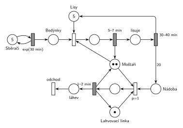

# 12–06 – Moštárna

## Zadání

> Dílna na produkci jablečného moštu (moštárna) leží vedle jablečného sadu. Moštárna obsahuje 5 poloautomatických lisů, sběrnou nádobu na mošt a jednu lahvovací linku. Ve firmě pracují dva moštaři a pět sběračů jablek. Sběrač v intervalech daný exponenciálním rozložením se středem 30 minut přináší do moštárny jednu bedýnku jablek. Každý moštař pracuje nezávisle a provádí dvě činnosti: 1) plnění lisů jablky, 2) lahvování. Lis pracuje dávkově s kapacitou danou obsahem jedné bedýnky jablek. Plnění lisu moštařem zabere 5-7 minut. Po naplnění lisu dále lis pracuje samostatně. Lisování zabere 30-40 minut a výsledkem je mošt o objemu na 20 lahví. Lisovaný mošt ze všech lisů jde do centrální záchytné nádoby (kapacitu neuvažujeme). Pokud je v záchytné nádobě nějaký mošt, pak moštař přednostně provádí lahvování dokud je nádoba neprázdná. Naplnění jedné lahve moštařem na lahvovací lince zabere 1-2 minuty.
>
> *Zadaný systém modelujte formou Petriho sítě s vyznačením všech potřebných parametrů.*

Věta „V modelu jednoznačně ukažte (přechodem) moment, kdy transakce opouští systém“ přibyla až v roce 2022/23. Výstupní přechod je v síti přesto, dnes se vyžaduje.

Podobné úlohy: [12–04 – Jahodová farma](<../12–04 - Jahodová farma/12–04 - Jahodová farma.md>) (stejné schéma: sběrači, stroje, balicí linka), [12–02 – Sběrači jahod](<../12–02 - Sběrači jahod/12–02 - Sběrači jahod.md>).

## Interpretace

Zobrazit interpretaci (nápověda)

- **Pět sběračů** je pět značek v místě generátoru. Časovaný přechod `exp(30 min)` má pro každou značku vlastní odpočet (slajd 138), takže každý sběrač nosí bedýnky nezávisle.
- **Plnění lisu** potřebuje bedýnku, volný lis a moštaře. Po `5–7 min` se moštař vrátí a lis pracuje dál sám `30–40 min`; pak se vrátí lis a do *Nádoby* přibude 20 značek (1 značka = mošt na 1 láhev).
- **Lahvování** potřebuje mošt, moštaře a lahvovací linku. Má `p=1`, tedy přednost před plněním lisu („přednostně“). Po každé lahvi se moštař i linka vrátí, a pokud je nádoba neprázdná, `p=1` je hned znovu obsadí. „Dokud je nádoba neprázdná“ tak platí bez dalšího prvku. Řešení z democvičení drží moštaře na lince smyčkou (`p=1` další láhev, `p=0` konec); chová se stejně.
- Linka je jen jedna, takže lahvuje vždy nejvýš jeden moštař; druhý mezitím plní lisy.
- **Transakce:** bedýnka se v lisu změní na 20 dávek moštu, každá dávka opouští systém jako naplněná láhev.
- **Systém je přetížený:** bedýnek přichází 10 za hodinu, 5 lisů jich zvládne asi 8,6 (35 min na lis) a jedna linka nalahvuje asi 40 lahví za hodinu z možných 200. Fronta bedýnek i nádoba rostou bez omezení; nádobu zadání výslovně neomezuje.

## Petriho síť

Zobrazit Petriho síť

| Požadavek | Prvek sítě |
|---|---|
| 5 sběračů, bedýnka po exp(30 min) | *Sběrači* (5) ⇄ `exp(30 min)` → *Bedýnky* |
| 5 lisů, 2 moštaři | *Lisy* (5), *Moštaři* (2) |
| plnění lisu 5–7 min (moštař) | obsazení lisu a moštaře, `5–7 min` vrací moštaře |
| lisování 30–40 min samostatně, mošt na 20 lahví | `30–40 min` vrací lis, hrana s váhou 20 do *Nádoby* |
| přednostně lahvování, jedna linka | `p=1`: *Nádoba* + moštař + *Lahvovací linka* |
| láhev 1–2 min | `1–2 min` vrací moštaře i linku → *láhev* → *odchod* |

Kontrola simulací: lisů je vždy celkem 5, moštařů 2, linka je nejvýš jedna obsazená. Za 310 h vzniklo asi 12 400 lahví (40 za hodinu), bedýnek čekalo na konci přes 900 a v nádobě přes 30 000 dávek, jak plyne z přetížení (proto `unbounded_ok`).

## Časté chyby

Zobrazit časté chyby

- Jeden sběrač místo pěti (jedna značka v generátoru).
- Moštař obsazený po celou dobu lisování. Zadání říká, že lis po naplnění pracuje samostatně.
- Lis vrácený už po naplnění, ne až po lisování.
- Lahvování bez priority, nebo dvě lahvovací linky (každý moštař „pracuje nezávisle“, ale linka je jedna).
- Hrana do nádoby bez váhy 20: jedna bedýnka by dala jen jednu láhev.

## Původ a zdroje

**Původ:** půlsemestrálky 2014–19 (přehled zadání), úloha Z16.

**Zdroje:**

- `Fitcheats/Půlsemestrálky/Zadání z minulých let/Přehled zadání 2014-19.pdf`, str. 4 (zadání)
- `Fitcheats/Půlsemestrálky/Democvičení 2020-21 - Z4 zadání a řešení.pdf`, str. 4 (zadání a řešení z democvičení)
- `Fitcheats/Půlsemestrálky/FIT - Příprava 2021-22.pdf`, str. 19 (studentské řešení, bez hlasů)

**Existující řešení:**

Zobrazit existující řešení

- **Democvičení 2020/21 (str. 4):** sběrači (5) ⇄ `exp(30m)` → „Fbed“ → obsazení „5 Lis“ a „2 Moštař“ → `5-7m` (vrací moštaře) → `30-40m` (vrací lis) → hrana `20` do „Nádoba“. Lahvování: „Lah“ (linka) + moštař + nádoba → `p=1` → láhev `1-2m` → `p=1` další láhev, dokud je mošt, jinak přechod, který vrátí linku a moštaře. Struktura je stejná jako tady, jen s explicitní smyčkou lahvování. Láhve nikam neodcházejí (výstupní přechod se tehdy nevyžadoval).
- **Příprava 2021/22 (str. 19):** stejné schéma, ale:
  - v místě *sběrači* je jen jedna značka; pět sběračů musí být pět značek;
  - zahájení lahvování nemá prioritu, takže „přednostně“ není zajištěno (`P=1` má jen pokračování smyčky);
  - chybí výstupní přechod.

