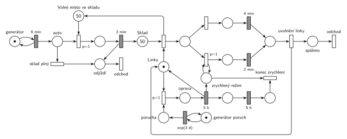

# 12–07 – Spalovna

## Zadání

> Do městské spalovny vozí odpad auta s kapacitou 1 kubík odpadu. Dovážka odpadu do spalovny probíhá rychlostí 10 kubíků odpadu za hodinu. Kapacita vstupního skladu přivezeného odpadu je 100 kubíků (sklad na počátku obsahuje 50 kubíků odpadu). Pokud není volná kapacita vstupního skladu, pak auto odjíždí nevyloženo. Vyložení auta trvá 2 minuty. Linka s pracovní kapacitou 1 kubík odpadu spaluje odpad rychlostí 15 kubíků za hodinu. V intervalech daných exponenciálním rozložením se středem 3 dny dochází na lince k poruše (porucha nepřeruší právě prováděné spalování jednotkového kubíku), jejíž oprava zabere 5 hodin. Po opravě se obnoví provoz linky a linka následujících 5 hodin zvýší rychlost spalování na 30 kubíků za hodinu.
>
> *Zadaný systém modelujte formou Petriho sítě s vyznačením všech potřebných parametrů.*

Věta „V modelu jednoznačně ukažte (přechodem) moment, kdy transakce opouští systém“ přibyla až v roce 2022/23. Výstupní přechody jsou v síti přesto, dnes se vyžadují.

Podobné úlohy: [12–05 – Spalovna se třemi vozy](<../12–05 - Spalovna se třemi vozy/12–05 - Spalovna se třemi vozy.md>), [03–06 – Porucha zničí obsluhu nebo počká](<../03–06 - Porucha zničí obsluhu nebo počká/03–06 - Porucha zničí obsluhu nebo počká.md>), [06–02 – MD1 – střídání 2 a 3](<../06–02 - MD1 – střídání 2 a 3/06–02 - MD1 – střídání 2 a 3.md>).

## Interpretace

Zobrazit interpretaci (nápověda)

- **Rychlosti jako časy:** 10 kubíků/h = auto každých `6 min` (konstantně, zadání dává rychlost, ne rozložení), 15 kubíků/h = `4 min` na kubík, 30 kubíků/h = `2 min`.
- **Kapacita skladu** je doplňkové místo *Volné místo ve skladu* (100 − 50 = 50 značek). Auto si při vjezdu vezme volné místo (`p=1`), jinak odjíždí nevyložené (*sklad plný*, `p=0`). Místo se zabere už na začátku vykládání, takže sklad nepřeteče ani s auty, která se právě vykládají. Uvolní se, když si kubík vezme linka.
- **Transakce jsou auto a kubík odpadu.** Auto po vyložení (nebo nevyložené) odjíždí, kubík odchází po spálení.
- **Linka** je zařízení s jednou značkou. Rychlost se zvolí při zahájení kubíku: ve zrychleném režimu se provede `p=1` větev `2 min`, jinak `4 min`. Kubík, který se začal pálit, se dopálí původní rychlostí.
- **Uvolnění linky** je tady samostatný okamžitý přechod, protože se do něj sbíhají obě větve. Vracet *Linku* přímo z obou časovaných přechodů je také správně, jen by se v obrázku křížily hrany.
- **Porucha nepřeruší spalování:** porucha čeká, až je linka volná, a pak ji obsadí s `p=1`, tedy dřív, než se začne pálit další kubík. Oprava `5 h` vrátí linku a zapne *zrychlený režim* a jeho odpočet `5 h`. Stav a odpočet jsou oddělené: stav testuje smyčka při každém zahájení, a kdyby byl vstupem časovaného `5 h`, odpočet by se pokaždé spustil znovu (slajd 139).
- Generátor poruch běží nezávisle, takže porucha může přijít i během opravy; pak hned po opravě následuje další.

## Petriho síť

Zobrazit Petriho síť

| Požadavek | Prvek sítě |
|---|---|
| auta 10 kubíků/h | *generátor* ⇄ `6 min` → *auto* |
| sklad 100 kubíků, na začátku 50 | *Sklad* (50) a *Volné místo ve skladu* (50) |
| plný sklad → auto odjíždí nevyložené | *sklad plný* (`p=0`) → *odjíždí* → *odchod* |
| vyložení 2 min | vjezd (`p=1`, bere volné místo) → `2 min` → *Sklad*, auto → *odjíždí* |
| linka 1 kubík, 15 kubíků/h | *Linka* (1), zahájení vrací volné místo, větev `4 min` |
| po opravě 5 h 30 kubíků/h | `p=1` větev `2 min` s testem *zrychlený režim* |
| poruchy exp(3 d), nepřeruší kubík | *generátor poruch* ⇄ `exp(3 d)` → *porucha*, obsazení linky `p=1` |
| oprava 5 h, pak 5 h zrychleně | `5 h` vrací *Linku*, zapne *zrychlený režim* a odpočet `5 h` → *konec zrychlení* |
| odchod ze systému | *odchod* auta, *odchod* spáleného kubíku |

Kontrola simulací: *Linka* + zpracovávaný kubík + oprava = 1, *Sklad* + *Volné místo* + vykládané = 100. Spalování (15/h) je rychlejší než dovážka (10/h), takže sklad se běžně vyprázdní a během jedné opravy přibude jen 50 kubíků. Plný sklad nastane jen tehdy, když porucha přijde během opravy (10 h bez spalování); proto běží simulace déle (300 000 událostí, asi 416 dní). Ze zhruba 100 000 aut odjela nevyložená jen 1 až 58 (podle běhu).

## Časté chyby

Zobrazit časté chyby

- Rychlost zapsaná jako parametr přechodu („10/h“) místo času mezi událostmi (`6 min`).
- Sklad jako místo s „kapacitou 100“. Kapacity míst se nepoužívají; místo nich doplňkové místo s volnými místy.
- Kontrola volného místa až po vyložení: auto by vykládalo do plného skladu.
- Porucha, která přeruší právě pálený kubík (zadání to výslovně vylučuje), nebo porucha bez priority, která čeká, až bude sklad prázdný.
- Zrychlený režim, který se po 5 h nevypne, nebo odpočet 5 h na místě testovaném smyčkou.

## Původ a zdroje

Zobrazit původ a zdroje

**Původ:** půlsemestrálky 2014–19 (přehled zadání), úloha Z15.

**Zdroje:**

- `Fitcheats/Půlsemestrálky/Zadání z minulých let/Přehled zadání 2014-19.pdf`, str. 4 (zadání)
- `Fitcheats/Půlsemestrálky/FIT - Příprava 2021-22.pdf`, str. 18 (studentské řešení, bez hlasů)

**Existující řešení:**

- **Příprava 2021/22 (str. 18):** auta `6m`, vyložení `2m`, *sklad* (50), přechod „odjezd“ se stavem „Plný“, linka s větvemi `4m` a `2m` přepínanými místy „norm“ a „rychle“, porucha `exp(3d)` „je nehoda“, oprava `5h`, zrychlení `5h`. Rychlosti přepočítané na časy jsou správně. Výhrady:
  - plnost skladu se zjišťuje dvojicí hran s váhou 100 na místě *sklad*; auta, která se právě vykládají, se do obsazenosti nepočítají, takže sklad může přetéct. Jak se stav „Plný“ vrací zpět, z obrázku jednoznačně nevyčtu;
  - chybí výstupní přechody;
  - síť je velmi nepřehledná (mnoho křížících se hran), nikdo pro ni nehlasoval.

