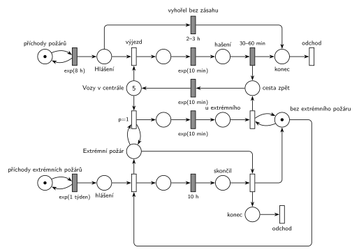

# 12–08 – Hasiči

## Zadání

> V regionu dochází ke vzniku požárů v intervalech daných exponenciálním rozložením se středem 8 hodin. Centrála hasičů dostává hlášení o novém požáru okamžitě po jeho vzniku. Nehašený požár trvá 2-3 hodiny, tj. po uplynutí této doby žádost o pomoc hasičů zaniká. Hasičská centrála má 5 hasičských vozů. K běžnému požáru je třeba výjezd jednoho vozu. Doba cesty vozu ke každému požáru se řídí exp 10 minut (symetricky cesta zpátky). Hašení požáru trvá 30-60 minut. V intervalech daných exp rozložením se středem 1 týden dochází k požáru extrémního rozsahu, která vyžaduje výjezd všech dostupných požárních vozů (všechny vozy dostupné v centrále, všechny vozy po návratu z běžného požáru). Extrémní požár po 10 hodinách skončí, tj. pak se vozy vrací.
>
> *Zadaný systém modelujte formou Petriho sítě s vyznačením všech potřebných parametrů.*

Věta „V modelu jednoznačně ukažte (přechodem) moment, kdy transakce opouští systém“ přibyla až v roce 2022/23. Výstupní přechody jsou v síti přesto, dnes se vyžadují.

Podobné úlohy: [09–18 – Nemocniční ambulance](<../09–18 - Nemocniční ambulance/09–18 - Nemocniční ambulance.md>), [02–01 – Netrpělivé požadavky](<../02–01 - Netrpělivé požadavky/02–01 - Netrpělivé požadavky.md>), [09–03 – Psí salon](<../09–03 - Psí salon/09–03 - Psí salon.md>).

## Interpretace

Zobrazit interpretaci (nápověda)

 

- **Transakce je požár** (hlášení), **vůz je zdroj**: *Vozy v centrále* je místo s 5 značkami. Výjezd spojí hlášení s vozem, po hašení požár odchází ze systému a vůz jede `exp(10 min)` zpět.
- **Nehašený požár 2–3 h** je časovaný přechod přímo na místě *Hlášení*: každé hlášení má vlastní odpočet (slajd 138), a když pro něj mezitím vyjede vůz, odpočet zanikne. Abstrakce: požár, ke kterému už vůz jede, nevyhoří (cesta trvá v průměru 10 min, tedy mnohem méně než 2–3 h).
- **Extrémní požár** má vlastní generátor `exp(1 týden)`. Vyhlášení vytvoří dvě značky: stav *Extrémní požár* a odpočet 10 h. Musí být oddělené: výjezd testuje stav smyčkou (vezme a vrátí značku), a kdyby stejné místo bylo vstupem časovaného přechodu `10 h`, každý výjezd by jeho odpočet zrušil a spustil znovu (slajd 139).
- **Výjezd všech dostupných vozů:** smyčka `p=1` bere vozy z centrály, dokud nějaký je a extrémní požár trvá. Má přednost před běžným výjezdem (`p=0`). Vůz, který se vrátí z běžného požáru, je v centrále a smyčka ho hned pošle dál. Přesně to je „všechny vozy po návratu z běžného požáru“.
- **Konec po 10 h:** přechod po místě *skončil* odebere stav *Extrémní požár*, vrátí značku *bez extrémního požáru* a extrémní požár odchází ze systému. Vozy *u extrémního* se vracejí přechodem s testem na *bez extrémního požáru*. Ten pošle zpět i vůz, který dojede až po skončení.
- Místo *bez extrémního požáru* zároveň brání tomu, aby se dva extrémní požáry překrývaly: další hlášení počká na konec prvního. To je zjednodušení, ale vzácné (10 h z týdne).
- Běžné požáry během extrémního čekají v *Hlášení* a většinou vyhoří (všechny vozy jsou pryč).

## Petriho síť

Zobrazit Petriho síť

 

| Požadavek | Prvek sítě |
|---|---|
| požáry po exp(8 h), hlášení hned | *generátor* ⇄ `exp(8 h)` → *Hlášení* |
| nehašený požár po 2–3 h zaniká | `2–3 h` z *Hlášení* do *konec* |
| 5 vozů, k běžnému požáru jeden | *Vozy v centrále* (5), *výjezd* |
| cesta exp(10 min) tam i zpět | `exp(10 min)` k požáru, `exp(10 min)` z *cesta zpět* do *Vozy v centrále* |
| hašení 30–60 min | `30–60 min`, požár → *konec*, vůz → *cesta zpět* |
| extrémní požár po exp(1 týden) | *generátor* ⇄ `exp(1 týden)` → *hlášení* → vyhlášení (s *bez extrémního požáru*) |
| výjezd všech dostupných vozů | smyčka `p=1` na *Extrémní požár*, `exp(10 min)` → *u extrémního* |
| po 10 h konec, vozy se vrací | `10 h` → *skončil* → konec extrémního požáru; test *bez extrémního požáru* pošle vozy na *cesta zpět* |
| odchod ze systému | dva výstupní přechody *odchod* (běžný a extrémní požár) |

Kontrola simulací: vozů je vždy celkem 5, *Extrémní požár* + *bez extrémního požáru* = 1. Za 215 týdnů proběhlo 237 extrémních požárů, při každém vyjelo v průměru 4,7 vozu (zbytek byl ještě u běžného požáru a vyjel po návratu). Asi 5 % běžných požárů vyhoří, skoro všechny během extrémního.

## Časté chyby

Zobrazit časté chyby

 

- Čekání na všech 5 vozů hranou s váhou 5 (před odpočtem 10 h nebo před návratem). „Všechny dostupné“ není „přesně pět“; na „všechny“ je potřeba smyčka s prioritou.
- Odpočet `10 h` na stejném místě, které testuje smyčka výjezdu: každý výjezd odpočet zruší a spustí znovu.
- Výjezd k extrémnímu požáru bez `p=1`: vůz vrácený z běžného požáru by mohl odjet k dalšímu běžnému.
- Zapomenutá cesta zpět (vůz se po hašení objeví v centrále hned).
- Vyhoření jako časovaný přechod až po výjezdu: pak by omezovalo hašení, ne čekání na vůz.

## Původ a zdroje

Zobrazit původ a zdroje

 

**Původ:** půlsemestrálky 2014–19 (přehled zadání), úloha Z13.

**Zdroje:**

- `Fitcheats/Půlsemestrálky/Zadání z minulých let/Přehled zadání 2014-19.pdf`, str. 3 (zadání)
- `Fitcheats/Půlsemestrálky/FIT - Příprava 2021-22.pdf`, str. 16 (studentské řešení s hlasováním)
- `Fitcheats/Příprava na zkoušku/luppo - Tabule.png` (řešení na tabuli, vpravo dole)

**Existující řešení:**

- **Příprava 2021/22 (str. 16):** stejné procesy: generátor `exp(8h)` → „nahlášen“, `2-3h` „nenahlášen“, vozy (5), `exp(10m)`, `30-60m`, `exp(10)` zpět; extrémní požár `exp(1t)`, výjezd `P=1` ve smyčce, `10h`. Chyby:
  - mezi okamžitým výjezdem a `exp(10m)` chybí místo (komentář pod řešením: „mezi prechody od hasicu a exp(10m) ma byt stav“);
  - návrat z extrémního požáru je jeden přechod s váhou 5, takže čeká, až u požáru bude všech 5 vozů. Pokud je některý ještě u běžného požáru, extrémní požár trvá déle než 10 h. Argument v komentáři („450min = 7.5h < 10h“) to neřeší: časy jsou exponenciální, tedy neomezené;
  - všech 5 vozů jede zpět jedním přechodem `exp(10m)`, ne každý zvlášť;
  - chybí výstupní přechody.
- **Tabule (luppo):** hlášení → `2-3h` „Vyhořelo“ / výjezd s *Vozů 5* → `exp(10)` → `30-60min` → vůz rovnou zpět do centrály (chybí cesta zpět). Extrémní požár: `exp(1t)` → „Hoří Token“, výjezd `P=2` ve smyčce → `exp(10)`. Odpočet `10h` má podle všeho na vstupu hranu s váhou 5, takže začne až po příjezdu všech pěti vozů; extrémní požár pak netrvá 10 h od vzniku.

