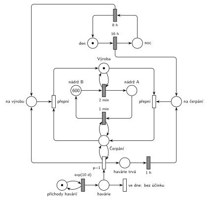

# 12–09 – Přečerpávací elektrárna II

## Zadání

> Systém vodní přečerpávací elektrárny je tvořen dvěma nádržemi A a B, obě s kapacitou 600 jednotek vody. Režim systému se dělí na: 1) denní etapu výroby (16 hodin), kdy se voda spouští z elektrárny B do A rychlostí 1 jednotka vody za 2 minuty do vyčerpání zásob a na 2) noční etapu spotřeby, kdy se voda z A čerpá do B rychlostí 1 jednotka za 1 minutu. V intervalech daných exp(10 dní) dochází v elektrizační soustavě k havárii vyžadující zvýšenou spotřebu elektřiny. Havárie trvá 1 hodinu. Pokud k havárii dojde v noční etapě, pak se na dobu havárie práce elektrárny přepne do denního (výrobního) režimu. Po dokončení havárie pokračuje systém v práci dle aktuální denní doby. V počátečním stavu začíná denní etapa a stav v nádržích je A: 0, B: 600.
>
> Zadaný systém modelujte formou Petriho sítě s vyznačením všech potřebných parametrů.

Podobné úlohy: [12–11 – Přečerpávací elektrárna](<../12–11 - Přečerpávací elektrárna/12–11 - Přečerpávací elektrárna.md>) (Z3, stejný systém s jinou havárií), [12–01 – Zahradnictví a bouřka](<../12–01 - Zahradnictví a bouřka/12–01 - Zahradnictví a bouřka.md>) (stav odděleně od časovačů), [12–12 – Uhelný mlýn](<../12–12 - Uhelný mlýn/12–12 - Uhelný mlýn.md>).

## Interpretace

Zobrazit interpretaci (nápověda)

 

- **Voda** jsou značky v nádržích *B* (600) a *A* (0). Přesun jedné jednotky je časovaný přechod: `2 min` z B do A (výroba), `1 min` z A do B (čerpání). „Do vyčerpání zásob“ zajistí samo vstupní místo: prázdná nádrž přechod zastaví.
- **Kapacita 600** se nemusí hlídat: voda se jen přelévá, takže A + B = 600 a žádná nádrž víc než 600 mít nemůže.
- **Režim** je místo *Výroba* nebo *Čerpání* (vždy jedna značka). Přesuny vody ho testují hranou tam a zpět. Když režim zmizí, rozběhnutý přesun jednotky zanikne.
- **Denní doba** je samostatný cyklus *den* → `16 h` → *noc* → `8 h`. Režim se přepíná signálem (*na čerpání*, *na výrobu*) a přechodem *přepni*. Časovače `16 h` a `8 h` jsou v jiných místech než testovaný režim, takže je testování nepřerušuje (stejně jako bouřka v 12–01).
- **Havárie v noci** (`p=1`, otestuje, že je režim *Čerpání*): pošle signál *na výrobu* a spustí odpočet `1 h`. Po hodině pošle signál *na čerpání*: systém pokračuje „dle aktuální denní doby“, tedy čerpá.
- **Den během havárie:** když v průběhu noční havárie skončí noc, signál *na výrobu* od `8 h` počká (přechod potřebuje *Čerpání*, a to teď není). Po konci havárie se režim přepne na čerpání a hned zase na výrobu, takže ráno platí den. Opačný případ (začátek noci během havárie) nastat nemůže: noční havárie skončí nejpozději hodinu po svém začátku.
- **Havárie ve dne** (p=0, režim *Čerpání* není) nemá účinek, elektrárna už vyrábí. Doslovně podle zadání se režim mění jen při havárii „v noční etapě“. Když denní havárie přesáhne do noci, noc začne normálně čerpáním.
- Transakce, která by opouštěla systém, tu není (voda koluje mezi nádržemi), proto síť nemá výstupní přechod. Zadání z let 2014–19 ho ani nevyžaduje.

## Petriho síť

Zobrazit Petriho síť

 

| Požadavek | Prvek sítě |
|---|---|
| nádrže A: 0, B: 600 | *nádrž A*, *nádrž B* (600 značek) |
| den: B → A, 1 jednotka za 2 min | `2 min`: *nádrž B* → *nádrž A*, test *Výroba* |
| noc: A → B, 1 jednotka za 1 min | `1 min`: *nádrž A* → *nádrž B*, test *Čerpání* |
| den 16 h, noc 8 h, začíná den | *den* (1) → `16 h` → *noc* → `8 h`; signály *na čerpání* / *na výrobu* → *přepni* |
| havárie exp(10 dní) | *generátor havárií* ⇄ `exp(10 d)` → *havárie* |
| havárie v noci: na 1 h výroba | `p=1`: *havárie* + test *Čerpání* → *na výrobu* + *havárie trvá* → `1 h` → *na čerpání* |
| havárie ve dne | *ve dne: bez účinku* (p=0) |

Kontrola simulací: A + B = 600, *Výroba* + *Čerpání* = 1, *den* + *noc* = 1, signály a *havárie trvá* mají nejvýš jednu značku. Za asi 314 simulovaných dní přišlo 22–36 havárií, z toho 9–10 v noci (noc je třetina dne). Počet přepnutí na čerpání = počet nocí + počet nočních havárií.

## Časté chyby

Zobrazit časté chyby

 

- Přesuny vody testují přímo místo s odpočtem `16 h` / `8 h`. Každý přesun značku vezme a vrátí a odpočet denní doby by se spouštěl znovu, takže by den nikdy neskončil.
- Havárie v noci vezme značku noci i s jejím časovačem. Po hodině se pak noc počítá znovu od začátku a denní doba se posune.
- Po havárii vždy návrat do čerpání, i když mezitím začal den. Zadání chce „dle aktuální denní doby“.
- Hlídání kapacity 600 doplňkovými místy. Neuškodí, ale je zbytečné, protože A + B = 600.
- „Do vyčerpání zásob“ řešené prioritou nebo inhibiční hranou. Je to zbytečné: prázdné vstupní místo přechod zastaví samo.

## Původ a zdroje

Zobrazit původ a zdroje

 

**Původ:** půlsemestrálky 2014–19 (přehled zadání), úloha Z11.

**Zdroje:**

- `Fitcheats/Půlsemestrálky/Zadání z minulých let/Přehled zadání 2014-19.pdf`, str. 3 (zadání)
- `Fitcheats/Příprava na zkoušku/luppo - Tabule.png` (studentské řešení na tabuli; jiné řešení v materiálech není)

**Existující řešení:**

- **Tabule luppo:** stejná myšlenka. Cyklus *den* → `16h` → *noc* → `8h` posílá signály, které přepínají značky *Den token* / *Noc token*, a přesuny vody `2min` a `1min` je testují. *Porucha* `exp(10)` → přechod `P=2`, který vezme *Noc token*, → `1hod`, a zeleně přidaná cesta s `p=2` spouští vodu z B během havárie. Druhý přechod z místa havárie odvádí denní havárie. Které hrany přesně vracejí *Noc token* po hodině, z fotky nejde spolehlivě přečíst.
- Hrubého řešení v materiálech není.

