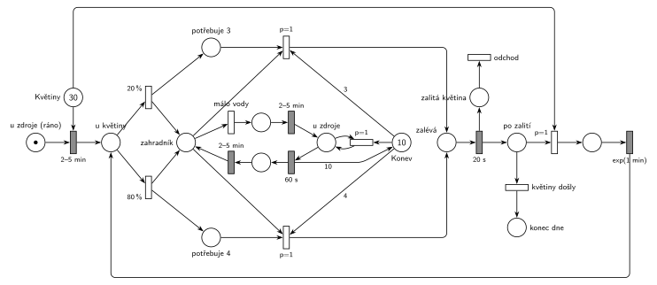

# 12–10 – Zahradník na FIT

## Zadání

> Zahradník na FIT má každý den zalít 30 květin v květináčích. Květiny obchází s konvicí o kapacitě 10 jednotek vody. Květina s pravděpodobností 20% vyžaduje 3 jednotky vody, jinak 4 jednotky vody. Zahradník napustí konvici do plné kapacity za 60 sekund. Cesta mezi zdrojem vody a libovolným květináčem nechť je 2-5 minut. Cesta mezi květináči nechť je dána exp. rozložením se středem 1 minuta. Pokud u květináče zahradník zjistí, že daná květina vyžaduje více vody než má aktuálně v konvici, pak se vrací vodu (cesta ke zdroji a zpět) v konvici doplnit. Zalití květiny trvá vždy 20 sekund. Zahradník je na počátku u zdroje vody a má naplněnou konvici. Modelujte jeden den práce zahradníka.
>
> Zadaný systém modelujte formou Petriho sítě s vyznačením všech potřebných parametrů.

Podobné úlohy: [12–01 – Zahradnictví a bouřka](<../12–01 - Zahradnictví a bouřka/12–01 - Zahradnictví a bouřka.md>) (obchůzka zahradníka po záhoncích), [11–10 – Bagrista a nákladní auta](<../11–10 - Bagrista a nákladní auta/11–10 - Bagrista a nákladní auta.md>) (jednotky materiálu jako značky s váhou hran).

## Interpretace

Zobrazit interpretaci (nápověda)

 

- **Voda** jsou značky v místě *Konev* (na začátku 10). Zalití odebere 3 nebo 4 značky hranou s váhou.
- **Potřeba květiny** se určí u květiny (20 % / 80 %) a **zůstane u ní** jako značka v *potřebuje 3* nebo *potřebuje 4*. Zahradník (místo *zahradník*) mezitím může odejít pro vodu. Po návratu se znovu jen porovná s konví, nelosuje se znovu: stejná květina potřebuje pořád stejně vody.
- **„Vyžaduje více vody, než má v konvi“:** přechody zalití mají `p=1` a hranu s váhou 3 nebo 4 z *Konve*. Jsou proveditelné, jen když je vody dost. Jinak se provede *málo vody* (p=0) a zahradník jde ke zdroji.
- **Napuštění do plné kapacity:** v síti nejde přímo „doplnit do 10“, protože místo neví, kolik mu chybí. U zdroje se proto nejdřív smyčkou `p=1` vylije zbytek vody (okamžitý přechod, opakuje se, dokud je v konvi něco) a pak `60 s` napustí 10 jednotek. Výsledek je stejný jako dolití: konev má po návratu 10 jednotek. Vylití proběhne v okamžiku příchodu ke zdroji, takže odpočet `60 s` tím nic nepřeruší (běží až potom).
- **Cesty:** od zdroje ke květině i zpět `2–5 min`, mezi květinami `exp(1 min)`. Cesta pro vodu je „ke zdroji a zpět“ ke stejné květině.
- **Jeden den** = zalít 30 květin. Když květiny dojdou (p=0 za *k další květině*), značka zahradníka skončí v *konec dne* a síť se zastaví. Že se síť zastaví, je tu tedy správně, ne chyba.
- **Výstup ze systému:** zahradník systém neopouští. Transakcí je tu květina: zalitá květina odchází přechodem *odchod* (stejně jako okopaný záhonek v 12–01).

## Petriho síť

Zobrazit Petriho síť

 

| Požadavek | Prvek sítě |
|---|---|
| ráno u zdroje s plnou konví, 30 květin | *u zdroje (ráno)* (1 značka), *Květiny* (30), *Konev* (10) |
| cesta od zdroje ke květině 2–5 min | `2–5 min` (vezme květinu) → *u květiny* |
| 20 % potřebuje 3, jinak 4 jednotky | `20 %` → *zahradník* + *potřebuje 3*; `80 %` → *zahradník* + *potřebuje 4* |
| zalití, je-li dost vody | `p=1`: *zahradník* + *potřebuje 3/4* + 3/4 × *Konev* → *zalévá* → `20 s` |
| málo vody: cesta ke zdroji a zpět | *málo vody* (p=0) → `2–5 min` → *u zdroje* → `60 s` → `2–5 min` → *zahradník* |
| napuštění do plné kapacity | *u zdroje*: vylití zbytku (`p=1`, smyčka), `60 s` dá 10 × *Konev* |
| cesta mezi květinami exp(1 min) | *po zalití* → *k další květině* (`p=1`, vezme květinu) → `exp(1 min)` → *u květiny* |
| jeden den práce | *květiny došly* (p=0) → *konec dne* |
| odchod transakce | *zalitá květina* → *odchod* |

Kontrola simulací: zahradník je vždy právě v jednom stavu a konev nikdy nemá víc než 10 jednotek. Den skončil po 146–165 minutách, zalito bylo vždy všech 30 květin a zahradník šel pro vodu 14krát (květiny spotřebují asi 114 jednotek, konev jich unese 10).

## Časté chyby

Zobrazit časté chyby

 

- Po návratu od zdroje znovu losovat 20 %/80 %. Potřeba patří květině, musí se pamatovat (místa *potřebuje 3/4*).
- Napuštění hranou s váhou 10 do konve, ve které ještě něco zbylo: konev pak má víc než 10 jednotek. Je potřeba buď vylít zbytek, nebo doplňkové místo s prázdnými jednotkami.
- Test „je dost vody“ jen jednou hranou bez priority. Zalití i cesta pro vodu jsou pak proveditelné zároveň a vybírá se náhodně.
- Zapomenuté `20 s` zalití nebo stejná cesta `2–5 min` i mezi květinami (mezi květinami je `exp(1 min)`).
- Konec dne bez priority: *květiny došly* by mohl předběhnout cestu k další květině.

## Původ a zdroje

Zobrazit původ a zdroje

 

**Původ:** půlsemestrálky 2014–19 (přehled zadání), úloha Z8.

**Zdroje:**

- `Fitcheats/Půlsemestrálky/Zadání z minulých let/Přehled zadání 2014-19.pdf`, str. 2 (zadání)
- `Fitcheats/Půlsemestrálky/FIT - Příprava 2021-22.pdf`, str. 12 (studentské řešení, 0 pro / 2 proti, s diskusí)
- `Fitcheats/Příprava na zkoušku/luppo - Tabule.png` (studentské řešení na tabuli)

**Existující řešení:**

- **Příprava 2021/22 (str. 12, 0 pro / 2 proti):** obrácené značení (šrafovaně okamžité, prázdně časované přechody). *zahradník* → `2-5m` → místo, kde se losuje `20%`/`80%`. Zalití bere 3/4 z *Konev* (10) a přesouvá je do místa *zalito*. Cesta pro vodu `2-5m` vede z míst po losování. Je to časovaný přechod, takže zalití (okamžitý přechod) má přednost i bez priority. U zdroje (*dopouštění*) se značky ze *zalito* vrátí do *Konev* a pak `60s`. To je správné doplnění „do plné kapacity“ pomocí doplňkového místa. Chyby: po napuštění jde zahradník přes `2-5m` znovu na losování `20%`/`80%`, takže se potřeba květiny losuje znovu. Úplně chybí zalití `20 s`.
- **Tabule luppo:** podobná síť (*Start* bere z *květiny* (30), *T get spotted* → `20%`/`80%`, váhy 3 a 4 z konve (10)). U *Musím naplnit* je `P1`, který podle všeho vylévá zbytek z konve, `P0` jde `2-5min` → `Naleju 60s` → `2-5` a vrací 10 jednotek. I tady se ale po návratu jde zpět na losování potřeby.

