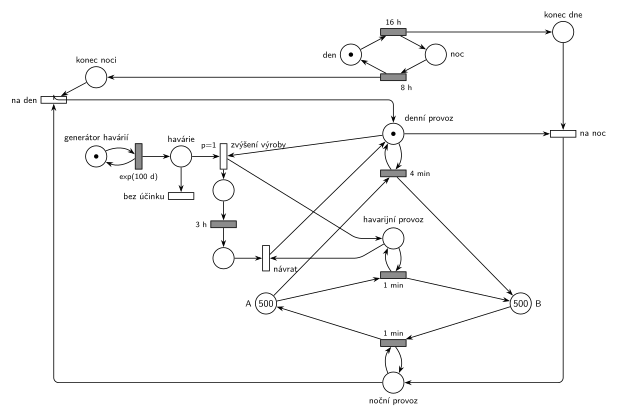

# 12–11 – Přečerpávací elektrárna

## Zadání

> Přečerpávací vodní elektrárna je složena ze dvou nádrží A a B. Každá nádrž má kapacitu 1000 jednotek vody. V počátečním stavu jsou obě naplněny 500 jednotkami vody. Elektrizační soustava pracuje v běžném denním provozu 16 hodin a v nočním provozu 8 hodin. V běžném denním provozu se spouští voda z nádrže A do nádrže B rychlostí jednotka vody za 4 minuty. V běžném nočním provozu se čerpá z B zpátky do A rychlostí jednotka vody za 1 minutu až do vyprázdnění nádrže B. V intervalech daných exponenciálním rozložením se středem 100 dní dochází k havárii v soustavě. Pokud tato havárie nastane v běžném denním provozu, pak elektrárna zvýší produkci tím, že spouští vodu z A do B rychlostí jednotka vody za 1 minutu do vyčerpání zásob, nejvýše však 3 hodiny. Potom se vrací do režimu dle denní doby.
>
> *Zadaný systém modelujte formou Petriho sítě s vyznačením všech potřebných parametrů.*

Podobné úlohy: [12–09 – Přečerpávací elektrárna II](<../12–09 - Přečerpávací elektrárna II/12–09 - Přečerpávací elektrárna II.md>) (Z11), [12–12 – Uhelný mlýn](<../12–12 - Uhelný mlýn/12–12 - Uhelný mlýn.md>), [12–01 – Zahradnictví a bouřka](<../12–01 - Zahradnictví a bouřka/12–01 - Zahradnictví a bouřka.md>) (stavová místa „je / není bouřka“).

## Interpretace

Zobrazit interpretaci (nápověda)

- **Voda** jsou značky v místech *A* a *B*. Přesun jednotky je časovaný přechod mezi nimi. Voda jen obíhá, žádná transakce systém neopouští, takže síť nemá výstupní přechod.
- **Kapacita 1000** nikdy nehraje roli: *A* + *B* = 1000 pořád, takže žádná nádrž víc než 1000 mít nemůže. „Až do vyprázdnění B“ a „do vyčerpání zásob“ zajišťuje sama sémantika: přechod bez značky ve vstupním místě se neprovede.
- **Režim** je jedna značka v *denní provoz*, *noční provoz*, nebo *havarijní provoz*. Každý přesun má smyčku (testovací hranu) na „svůj“ režim: `4 min` A → B ve dne, `1 min` B → A v noci, `1 min` A → B při havárii.
- **Hodiny** (*den* → `16 h` → *noc* → `8 h` → *den*) běží nezávisle na režimu. Konec dne a konec noci jen vloží signál (*konec dne*, *konec noci*) a okamžité přechody *na noc* / *na den* přepnou režim. Hodiny nesmějí být přímo místy režimu: přechody `16 h` a `8 h` by se pak rušily při každém přesunu vody, který místo režimu testuje (slajd 139).
- **Havárie** je samostatný generátor `exp(100 d)`. Ve dne (je značka *denní provoz*) přechod *zvýšení výroby* (`p=1`) vymění režim za *havarijní provoz* a spustí `3 h`. V noci nebo během jiné havárie se provede *bez účinku* (p=0) a havárie zanikne.
- **Konec havárie:** `3 h` běží na vlastním místě (ne na *havarijním provozu*, který každou minutu testuje přesun). *Návrat* vrátí *denní provoz*. Pokud mezitím skončil den, čeká signál *konec dne* a režim se hned přepne na noční. To je „vrací se do režimu dle denní doby“; hodiny se havárií neposouvají.
- **„Nejvýše však 3 hodiny“:** za 3 h odteče nejvýš 180 jednotek a v *A* je na začátku havárie vždy víc (nejméně asi 260 na konci prvního dne), takže zásoby nedojdou a havarijní provoz trvá vždy celé 3 h.

## Petriho síť

Zobrazit Petriho síť

| Požadavek | Prvek sítě |
|---|---|
| nádrže, na počátku 500 + 500 | *A* (500), *B* (500) |
| den 16 h, noc 8 h | *den* → `16 h` → *noc* → `8 h` → *den*, signály *konec dne* / *konec noci* |
| přepnutí režimu | *na noc*: *konec dne* + *denní provoz* → *noční provoz*; *na den* obráceně |
| den: A → B po 4 min | *denní provoz* ⇄ `4 min`: *A* → *B* |
| noc: B → A po 1 min do vyprázdnění B | *noční provoz* ⇄ `1 min`: *B* → *A* |
| havárie exp(100 d) | *generátor havárií* ⇄ `exp(100 d)` → *havárie* |
| havárie ve dne: A → B po 1 min, 3 h | *zvýšení výroby* (p=1) → *havarijní provoz* ⇄ `1 min` a `3 h` → *návrat* |
| havárie v noci | *bez účinku* (p=0) |

Kontrola simulací (asi 600 dní): *A* + *B* = 1000, *den* + *noc* = 1, právě jeden režim, žádná nádrž nepřekročí 1000. Za den proteče asi 240 jednotek A → B a stejně zpět. Havárie ve dne převede 179–180 jednotek, havárie v noci zanikne bez účinku. Ověřen i scénář havárie v 15 h: havarijní provoz běží do 18 h a pak se režim rovnou přepne na noční.

## Časté chyby

Zobrazit časté chyby

- Přesuny vody s testovací hranou přímo na místa hodin (*den*, *noc*), ze kterých čte i `16 h` / `8 h`. Každý přesun pak odpočet hodin zruší (slajd 139).
- Havárie, která ve dne jen přidá rychlejší přesun a neodebere denní režim. Pak běží `4 min` i `1 min` současně.
- Návrat z havárie natvrdo do denního režimu, i když mezitím začala noc.
- Havárie v noci bez přechodu, který ji odstraní: značka čeká a zvýší výrobu ráno.
- Hodiny, které se během havárie zastaví (`16 h` se spustí až po návratu): den se tím prodlouží.

## Původ a zdroje

**Původ:** půlsemestrálky 2014–19 (přehled zadání), úloha Z3. Přesný rok a varianta nejsou známé.

**Zdroje:**

- `Fitcheats/Půlsemestrálky/Zadání z minulých let/Přehled zadání 2014-19.pdf`, str. 1 (zadání)
- `Fitcheats/Půlsemestrálky/FIT - Příprava 2021-22.pdf`, str. 7 (studentské řešení)
- `Fitcheats/Příprava na zkoušku/luppo - Tabule.png` (studentské řešení na tabuli)

**Existující řešení:**

Zobrazit existující řešení

- **Studentské řešení (Příprava 2021/22, str. 7, bez hlasů, komentář „opraveno“, ale nepřehledné):** stejná myšlenka hodin: *den* → `16h` → *noc* → `8h` se signálními místy a stavová místa *denní provoz* / *noční provoz* přepínaná okamžitými přechody. Dále *A* (500), *B* (500), přesuny `4m` a `1m`, generátor `exp(100d)` → *je havárie* a časovač `3h`, místo *A při havárii* s přesunem `1m` a `p=1`. Generátor se obnovuje až po 3 h, i když havárie nastala v noci. Jak přesně se havarijní provoz ukončí a vrátí denní provoz, se z kresby spolehlivě přečíst nedá.
- **Tabule luppo:** *A* (500), *B* (500), přesuny `4min` a `1min`, hodiny `16h` / `8h` s místy *Den* a *Noc*, `Exp(100)` → *Můžu přečerpat* a `3hod`. Leží v červeně ohraničené části tabule.
- Hrubého řešení ani řešení ze cvičení v materiálech není.

