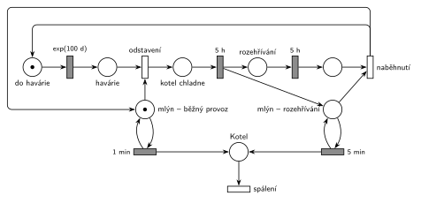

# 12–12 – Uhelný mlýn

## Zadání

> Do kotle uhelné elektrárny přikládá uhlí uhelný mlýn zabezpečující přísun a zpracování paliva pro kotel. V režimu běžného provozu vhazuje mlýn do kotle dávku paliva v intervalu 1 minuta. V intervalech daných exponenciálním rozložením se středem 100 dní dochází v elektrizační soustavě k havárii, která si vynutí okamžité odstavení elektrárny. Během odstávky mlýn nedodává kotli palivo a kotel 5 hodin chládne. Po vychladnutí kotle lze elektrárnu opět zapojit. Opětovný start elektrárny zabere dalších 5 hodin pomalého rozehřívání, kdy mlýn vhazuje dávku paliva v intervalech 5 minut. Po dokončení rozehřívací fáze může mlýn začít zásobovat kotel dle intervalu běžného režimu. Interval mezi haváriemi se počítá od posledního naběhnutí elektrárny do běžného režimu nebo od počátku modelového času.
>
> *Zadaný systém modelujte formou Petriho sítě s vyznačením všech potřebných parametrů.*

Podobné úlohy: [12–07 – Spalovna](<../12–07 - Spalovna/12–07 - Spalovna.md>) (porucha, oprava 5 h a pak 5 h zrychlený provoz), [09–07 – Automat na kávu](<../09–07 - Automat na kávu/09–07 - Automat na kávu.md>) (další porucha se počítá od konce opravy), [12–11 – Přečerpávací elektrárna](<../12–11 - Přečerpávací elektrárna/12–11 - Přečerpávací elektrárna.md>).

## Interpretace

Zobrazit interpretaci (nápověda)

- **Transakce** jsou dávky paliva: mlýn je vhazuje do *Kotle* a tam shoří (výstupní přechod *spálení*). Dobu hoření zadání neuvádí, takže je nulová.
- **Mlýn** je jedna značka, která je vždy v jednom ze tří stavů: *mlýn – běžný provoz* (smyčka `1 min` vhazuje dávku), *kotel chladne* (mlýn nedodává nic) a *mlýn – rozehřívání* (smyčka `5 min`). Dvě místa pro mlýn tedy nejsou dva mlýny, ale dva stavy téhož mlýna (to byla otázka v komentáři k jednomu ze studentských řešení).
- **Okamžité odstavení:** okamžitý přechod *odstavení* vezme značku mlýna z běžného provozu. Odpočet `1 min` tím zanikne (slajd 139) a mlýn rozpracovanou dávku nedodá.
- **Interval mezi haváriemi** měří samostatné místo *do havárie*. Značku do něj vrací až *naběhnutí* do běžného režimu, takže odpočet `exp(100 d)` začíná znovu od naběhnutí (a na začátku od času 0). Během odstávky a rozehřívání havárie nastat nemůže.
- **Proč je rozehřívání ve dvou místech:** smyčka `5 min` každých 5 minut odebere a vrátí značku *mlýn – rozehřívání*. Kdyby z téhož místa četl i přechod `5 h`, jeho odpočet by se podle slajdu 139 pokaždé zrušil a začal znovu. Proto běží `5 h` na vlastním místě *rozehřívání* a *naběhnutí* pak vezme obě značky.
- **Chladnutí a rozehřívání** jsou pevné doby `5 h`. „Lze elektrárnu opět zapojit“ chápeme tak, že se zapojí hned po vychladnutí.

## Petriho síť

Zobrazit Petriho síť

| Požadavek | Prvek sítě |
|---|---|
| běžný provoz: dávka po 1 min | *mlýn – běžný provoz* ⇄ `1 min` → *Kotel* |
| havárie exp(100 d) od naběhnutí | *do havárie* → `exp(100 d)` → *havárie* |
| okamžité odstavení | *odstavení*: *havárie* + *mlýn – běžný provoz* → *kotel chladne* |
| kotel chladne 5 h, mlýn nedodává | *kotel chladne* → `5 h` |
| rozehřívání 5 h, dávka po 5 min | `5 h` → *rozehřívání* + *mlýn – rozehřívání*; *mlýn – rozehřívání* ⇄ `5 min` → *Kotel*; *rozehřívání* → `5 h` |
| návrat do běžného režimu | *naběhnutí*: vrací *mlýn – běžný provoz* a *do havárie* |
| dávka shoří | *Kotel* → *spálení* |

Kontrola simulací: mlýn je vždy právě v jednom stavu (*mlýn – běžný provoz* + *kotel chladne* + *mlýn – rozehřívání* = 1) a cyklus elektrárny má jednu značku. Za asi 210 simulovaných dní nastaly ve dvou ze tří běhů 4 havárie, v jednom žádná. Při každém rozehřívání mlýn vhodí 59–60 dávek (5 h / 5 min).

## Časté chyby

Zobrazit časté chyby

- Generátor havárií jako obyčejná smyčka, která běží i během odstávky. Pak se interval nepočítá od naběhnutí a havárie může přijít uprostřed rozehřívání.
- Odstavení, které nevezme značku mlýna: mlýn pak vhazuje palivo i do chladnoucího kotle.
- Přechod `5 h` rozehřívání čte stejné místo jako smyčka `5 min`. Podle slajdu 139 se jeho odpočet každých 5 minut ruší a rozehřívání nikdy neskončí.
- Chybějící počáteční značky (mlýn v běžném provozu, odpočet do havárie).
- Návrat do běžného provozu bez vrácení značky *do havárie*: další havárie už nikdy nenastane.

## Původ a zdroje

**Původ:** půlsemestrálky 2014–19 (přehled zadání), úloha Z2. Přesný rok a varianta nejsou známé.

**Zdroje:**

- `Fitcheats/Půlsemestrálky/Zadání z minulých let/Přehled zadání 2014-19.pdf`, str. 1 (zadání)
- `Fitcheats/Půlsemestrálky/FIT - Příprava 2021-22.pdf`, str. 5–6 (dvě studentská řešení s hlasováním)

**Existující řešení:**

Zobrazit existující řešení

- **Studentské řešení (Příprava 2021/22, str. 5, souhlasí 3, nesouhlasí 1):** místa *BĚŽNÝ PROVOZ* a *MLÍN*, přechody `exp(100d)`, `5h`, `5h`, smyčky `1min` a `5min`, několik přechodů `prio 1`. Komentář: počáteční značky mají být v *mlýn* a *běžný provoz*. Bez nich se síť vůbec nerozběhne.
- **Studentské řešení (str. 6, souhlasí 2, nesouhlasí 0, netuší 1):** skoro stejné jako síť výše. *mlýn norm.* ⇄ `1m`, generátor `exp(100d)`, `P=1` přechod sebere značku normálního mlýna, *chladne* `5h`, *start el.*, *rozehřívá se* `5h`, *mlýn po výpadku* ⇄ `5m` a závěrečný `P=1`, který vrátí normální mlýn a znovu spustí generátor havárií. Komentář se ptá, zda je v pořádku mít mlýn ve dvou místech (je, jde o dva stavy jedné značky), a navrhuje po havárii jít rovnou do *chladne*.
- Hrubého řešení ani řešení ze cvičení v materiálech není.

