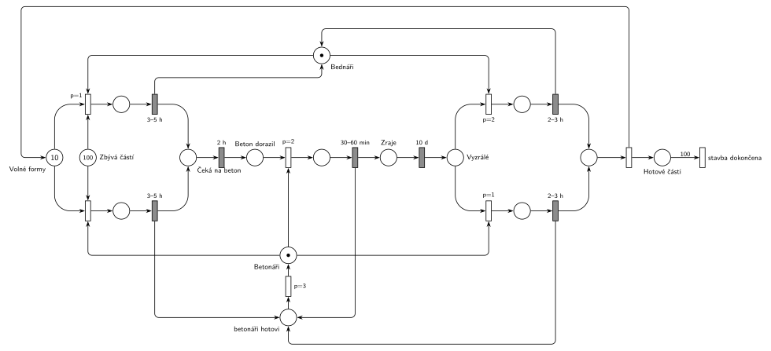

# 12–13 – Stavba z betonu

## Zadání

> Pro dokončení stavby budovy z betonu je třeba provést 100 elementárních betonových stavebních částí. Na stavbě pracuje jedna parta bednářů a jedna parta betonářů. Pro zbudování jedné stavební části je třeba 1) připravit licí formu pro lití betonu (dělají bednáři, trvá 3-5 hodin), 2) do formy nalít beton (dělají betonáři, trvá 30-60 minut), 3) beton nechat uzrát 10 dní a 4) licí formu odstranit (dělají bednáři, trvá 2-3 hodiny). Na stavbě je k dispozici 10 licích forem. V situaci, kdy lze někde licí formu zbudovat a jinde licí formu po vyzrání betonu odstranit, bednáři přednostně vykonávají odstraňování forem.
>
> Po dokončení přípravy licí formy se odešle požadavek na dodávku betonu. Dodávka dorazí za dvě hodiny po zavolání. Pokud nemají betonáři dodávku betonu pro lití do zbudované formy, pak se na jeden úkon (příprava nebo odstranění formy) přidávají k bednářům.
>
> *Zadaný systém modelujte formou Petriho sítě s vyznačením všech potřebných parametrů.*

Věta „V modelu jednoznačně ukažte (přechodem) moment, kdy transakce opouští systém“ přibyla až v roce 2022/23. Výstupní přechod je v síti přesto, dnes se vyžaduje.

Podobné úlohy: [12–15 – Dílna se třemi stroji](<../12–15 - Dílna se třemi stroji/12–15 - Dílna se třemi stroji.md>), [12–17 – Chmelová brigáda](<../12–17 - Chmelová brigáda/12–17 - Chmelová brigáda.md>), [09–19 – Banka se třemi pracovníky](<../09–19 - Banka se třemi pracovníky/09–19 - Banka se třemi pracovníky.md>).

## Interpretace

Zobrazit interpretaci (nápověda)

- **Transakcí je licí forma.** Značka z *Volných forem* projde přípravou, čekáním na beton, litím, zráním a odstraněním a vrátí se zpět. *Zbývá částí* (100 značek) hlídá, kolik částí se ještě má začít; příprava bere jednu značku z obou míst.
- **Objednávka betonu:** po přípravě forma přejde do *Čeká na beton*, časovaný přechod `2 h` je dodávka. Každá forma má vlastní odpočet (slajd 138), takže dodávky pro různé formy běží souběžně. **Zrání `10 d`** funguje stejně.
- **Bednáři a betonáři** jsou dvě zařízení s 1 značkou. Uvolnění je sloučené s časovaným přechodem.
- **Přednost odstraňování:** odstranění bednáři má `p=2`, příprava bednáři `p=1`. Když je volná forma i vyzrálá forma, bednáři si vyberou odstranění.
- **„Betonáři se přidávají k bednářům“** čteme tak, že betonáři bez betonu udělají jeden úkon bednářů (přípravu nebo odstranění formy) jako druhá parta se stejnými dobami. Proto jsou příprava a odstranění nakreslené dvakrát: nahoře s bednáři, dole s betonáři. Priority: lití `p=2` > odstranění betonáři `p=1` > příprava betonáři `p=0`. Betonáři tedy vezmou cizí úkon, jen když nemají co lít, a i oni dávají přednost odstraňování. O stejný úkon mají přednost bednáři (`p=2` > `p=1`, `p=1` > `p=0`).
- „Na jeden úkon“ znamená, že po něm se betonáři vrátí do svého místa a znovu se rozhoduje, jestli už dorazil beton. Jiné čtení „přidávají se k bednářům“ (společná práce je rychlejší) by potřebovalo dobu, kterou zadání neuvádí.
- **Konec:** po odstranění formy přibude značka v *Hotové části*. Přechod s hranou váhy 100 je okamžik, kdy je stavba hotová. Pak se síť zastaví, je to konečný proces.

## Řešení

Zobrazit řešení

| Požadavek | Prvek sítě |
|---|---|
| 100 částí, 10 forem | *Zbývá částí* (100), *Volné formy* (10) |
| příprava formy bednáři 3–5 h | `p=1`: forma + část + *Bednáři* → `3–5 h` (vrací bednáře) → *Čeká na beton* |
| dodávka betonu za 2 h po zavolání | *Čeká na beton* → `2 h` → *Beton dorazil* |
| lití betonáři 30–60 min | `p=2`: *Beton dorazil* + *Betonáři* → `30–60 min` (vrací betonáře) → *Zraje* |
| zrání 10 dní | *Zraje* → `10 d` → *Vyzrálé* |
| odstranění formy bednáři 2–3 h, přednostně | `p=2`: *Vyzrálé* + *Bednáři* → `2–3 h` → *Volné formy* + *Hotové části* |
| betonáři bez betonu pomáhají na jeden úkon | dolní kopie přípravy (`p=0`) a odstranění (`p=1`) s *Betonáři* |
| stavba dokončena | *Hotové části* → váha 100 → *stavba dokončena* |

Kontrola simulací: forem je vždy 10 (volné + všechny rozpracované), bednáři i betonáři se vždy vrátí. Stavba trvá asi 106 dní. Betonáři udělají 40–47 % příprav i odstranění, protože na beton většinu času jen čekají.

## Časté chyby

Zobrazit časté chyby

- Formy jako nekonečný zdroj: chybí místo s 10 značkami a návrat formy po odstranění.
- Přednost odstraňování bez priorit (nebo s prioritou na špatném přechodu): bednáři by mohli stavět nové formy, zatímco vyzrálé čekají.
- Dodávka betonu jako jeden společný časovač: dodávky pro různé formy se pak „řadí“ za sebou.
- Betonáři, kteří pomáhají bednářům, i když beton dorazil (chybí `p=2` na lití).
- Chybějící konec stavby po 100 částech; počítadlo *Zbývá částí* samo nic neukončí.

## Původ a zdroje

**Původ:** půlsemestrální písemka 2013/14, varianta D, 6 bodů (k příkladu patřila ještě otázka z teorie za 4 body).

**Zdroje:**

- `Fitcheats/Půlsemestrálky/Zadání z minulých let/2013-14.pdf`, str. 2 (zadání) a str. 3 (hlavička varianty D s bodováním)
- `Fitcheats/Skripta/FIT - Studentská skripta 2015-16.pdf`, str. 51 (zadání zapsané po paměti, bez řešení)

**Existující řešení:**

Zobrazit existující řešení

- **Studentská skripta (str. 51):** jen zadání zapsané po paměti, řešení chybí. Je v něm „Pokud betonáři nemají dodávku betonu, přidávají se na jeden úkol k bednářům“, tedy stejný smysl jako v originálu.
- Jiné řešení v materiálech není.

