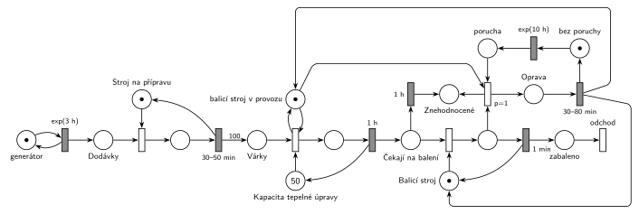

# 12–14 – Výroba hrášku

## Zadání

> Automatizovaná výrobní linka na výrobu konzervovaného hrášku má charakter pásové výroby a je složena ze třech výrobních operací: příprava, tepelná úprava a balení. K lince přijíždí v intervalech daných exponenciálním rozložením se středem 3 hodiny dodávka sklizeného hrášku. Stroj na přípravu hrášku dodávku zpracovává 30-50 minut a výsledkem operace je 100 přepravních várek polotovaru. Přepravní várky dále postupují linkou samostatně. Následuje zpracování polotovaru na stroji pro tepelnou úpravu polotovaru, který má kapacitu 50 přepravních várek. Tepelné zpracování přepravní várky trvá 1 hodinu. Posledním v řetězci je stroj na balení s kapacitou 1 přepravní várka. Balení jedné várky trvá 1 minutu.
>
> V intervalech daných exponenciálním rozložením se středem 10 hodin dochází na balícím stroji k poruše, která se projeví během jeho balící činnosti. Odstranění poruchy trvá 30-80 minut. Během poruchy nevstupují nové přepravní várky do operace tepelné úpravy. Aktuální várka v balícím stroji je znehodnocena. Přepravní várky čekající na balení mají trvanlivost 1 hodinu. Po uplynutí doby trvanlivosti jsou znehodnoceny. Během poruchy balícího stroje pokračuje rozpracovaná operace tepelné úpravy. V modelu evidujte jedním místem počet znehodnocených přepravních várek.
>
> *Zadaný systém modelujte formou Petriho sítě s vyznačením všech potřebných parametrů.*

Věta „V modelu jednoznačně ukažte (přechodem) moment, kdy transakce opouští systém“ přibyla až v roce 2022/23. Výstupní přechod je v síti přesto, dnes se vyžaduje.

Podobné úlohy: [03–01 – Porucha zruší obsluhu](<../03–01 - Porucha zruší obsluhu/03–01 - Porucha zruší obsluhu.md>), [03–04 – Porucha s opravou, transakce odchází](<../03–04 - Porucha s opravou, transakce odchází/03–04 - Porucha s opravou, transakce odchází.md>), [09–11 – Kopírovací centrum s poruchami](<../09–11 - Kopírovací centrum s poruchami/09–11 - Kopírovací centrum s poruchami.md>), [02–01 – Netrpělivé požadavky](<../02–01 - Netrpělivé požadavky/02–01 - Netrpělivé požadavky.md>), [12–18 – Logistická centrála](<../12–18 - Logistická centrála/12–18 - Logistická centrála.md>).

## Interpretace

Zobrazit interpretaci (nápověda)

- **Dodávka → 100 várek:** dodávka je transakce jen do konce přípravy. Časovaný přechod `30–50 min` má výstupní hranu s váhou 100, dál putují várky samostatně.
- **Tepelná úprava s kapacitou 50** je sklad s 50 značkami. Časovaný přechod `1 h` neomezuje počet současně čekajících (slajd 138), takže v úpravě může být až 50 várek naráz, každá s vlastním odpočtem. **Balicí stroj** je zařízení s 1 značkou.
- **Trvanlivost 1 h** je časovaný přechod přímo na místě *Čekají na balení* (jako netrpělivost): každá čekající várka má vlastní odpočet, a když ji mezitím obsadí balicí stroj, odpočet zanikne.
- **„Porucha, která se projeví během balící činnosti“:** porucha vznikne po `exp(10 h)` a čeká v místě *porucha*, dokud stroj nebalí. Okamžitý přechod `p=1` pak vezme právě balenou várku (odpočet `1 min` zanikne, slajd 139) a pošle ji mezi *Znehodnocené*, stroj jde do *Opravy*. Proces poruch je cyklus: další porucha se plánuje až po opravě, takže se poruchy nehromadí.
  - Jiné čtení: porucha, která přijde, když stroj nebalí, nemá účinek (zánik s `p=0` jako v [03–02 – Porucha vrací transakci do fronty](<../03–02 - Porucha vrací transakci do fronty/03–02 - Porucha vrací transakci do fronty.md>)). Balicí stroj je ale většinu času v činnosti, takže se obě čtení liší málo.
- **„Během poruchy nevstupují várky do tepelné úpravy“:** místo *balicí stroj v provozu* (1 značka) je testováno dvojicí hran na obsazení tepelné úpravy. Projev poruchy značku vezme, konec opravy ji vrátí. Rozpracovaná tepelná úprava běží dál, protože časovaný přechod `1 h` na tom místě nezávisí.
- **Čítač znehodnocených** je jedno místo bez výstupu (počet značek = počet znehodnocených várek); vedou do něj trvanlivost i projev poruchy. Ze systému odcházejí jen zabalené várky.

## Petriho síť

Zobrazit Petriho síť

| Požadavek | Prvek sítě |
|---|---|
| dodávky po exp(3 h) | *generátor* ⇄ `exp(3 h)` → *Dodávky* |
| příprava 30–50 min, výsledek 100 várek | *Stroj na přípravu* (1 značka), obsazení, `30–50 min` (vrací stroj) → váha 100 → *Várky* |
| tepelná úprava, kapacita 50, 1 h | *Kapacita tepelné úpravy* (50 značek), obsazení, `1 h` vrací značku |
| balení, kapacita 1, 1 min | *Balicí stroj* (1 značka), obsazení, `1 min` vrací stroj → *zabaleno* → *odchod* |
| trvanlivost čekajících 1 h | *Čekají na balení* → `1 h` → *Znehodnocené* |
| poruchy po exp(10 h), projev při balení | *bez poruchy* → `exp(10 h)` → *porucha* → `p=1` s balenou várkou |
| znehodnocení balené várky, oprava 30–80 min | `p=1`: várka → *Znehodnocené*, stroj → *Oprava* → `30–80 min` → *Balicí stroj* |
| během poruchy nevstupují várky do úpravy | test místa *balicí stroj v provozu* na obsazení úpravy; porucha ho vezme, oprava vrátí |
| počet znehodnocených várek | místo *Znehodnocené* |

Kontrola simulací: platí *Kapacita* + v úpravě = 50, *Balicí stroj* + balená várka + *Oprava* = 1 a *v provozu* + *Oprava* = 1, čekajících na balení je nejvýš 50. Znehodnotí se asi 9 % várek, většinou při opravách. Fronta várek před úpravou je stabilní (zátěž asi 0,7), ale dodávka přidá 100 várek naráz, takže občas přesáhne 500.

## Časté chyby

Zobrazit časté chyby

- Kapacita tepelné úpravy jako kapacita místa místo skladu s 50 značkami (Hrubý se kapacitám míst vyhýbá).
- Trvanlivost jako jeden časovač pro celou frontu místo časovaného přechodu přímo na místě *Čekají na balení*.
- Porucha, která odebere várku, ale nezablokuje vstup do tepelné úpravy, nebo naopak přeruší i rozpracovanou tepelnou úpravu.
- Oprava bez vrácení značky *Balicímu stroji* nebo místu *v provozu*: linka se zastaví navždy.
- Znehodnocené várky poslané rovnou na výstupní přechod: pak se nedají spočítat, a zadání chce jejich počet evidovat.

## Původ a zdroje

**Původ:** půlsemestrální písemka 2013/14, varianta B, 6 bodů (k příkladu patřila ještě otázka z teorie za 4 body).

**Zdroje:**

- `Fitcheats/Půlsemestrálky/Zadání z minulých let/2013-14.pdf`, str. 1 (zadání) a str. 3 (hlavička písemky s bodováním)
- `Fitcheats/Skripta/FIT - Studentská skripta 2015-16.pdf`, str. 50 (zadání zapsané po paměti, bez řešení)

**Existující řešení:**

Zobrazit existující řešení

- **Studentská skripta (str. 50):** jen zadání zapsané po paměti („Je to z hlavy, tak mě kdyžtak opravte“), řešení chybí. Obsahově odpovídá originálu, závazný je ale text z `2013-14.pdf`.
- Jiné řešení v materiálech není.

