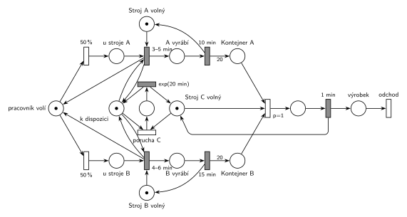

# 12–15 – Dílna se třemi stroji

## Zadání

> V dílně jsou tři stroje - A, B a C. Stroje A a B obsluhuje jeden pracovník, stroj C pracuje samostatně. Ke strojům A a B přistupuje pracovník s rovnoměrnou pravděpodobností. Obsluha stroje spočívá v přípravě výrobní operace, která zabere 3-5 min u stroje A a 4-6 min u stroje B. Po přípravě operace stroje už operaci dokončí samy v době 10 min u stroje A a 15 min u stroje B. Výsledkem výrobní operace na A a B je 20 kusů mezivýrobku, které jsou umístěny ve výstupním kontejneru stroje s neomezenou kapacitou. Stroj C v každém cyklu bere současně mezivýrobek z A a B z výstupních kontejnerů operací. Pokud nemá tyto mezivýrobky, dojde u něj k poruše, která vyžaduje okamžitou opravu pracovníkem. Obsluha opravy zabere exp(20 min). Pracovník obnoví po návratu z opravy poruchy svou předchozí činnost od jejího počátku. Výrobní cyklus stroje C trvá vždy 1 minutu.
>
> Modelujte zadaný systém ve formě Petriho sítě s vyznačením všech potřebných parametrů.

Věta „V modelu jednoznačně ukažte (přechodem) moment, kdy transakce opouští systém“ přibyla až v roce 2022/23. Výstupní přechod je v síti přesto, dnes se vyžaduje.

Podobné úlohy: [03–02 – Porucha vrací transakci do fronty](<../03–02 - Porucha vrací transakci do fronty/03–02 - Porucha vrací transakci do fronty.md>) (přerušená činnost začíná znovu), [12–13 – Stavba z betonu](<../12–13 - Stavba z betonu/12–13 - Stavba z betonu.md>), [12–12 – Uhelný mlýn](<../12–12 - Uhelný mlýn/12–12 - Uhelný mlýn.md>).

## Interpretace

Zobrazit interpretaci (nápověda)

 

- **Pracovník** je jedna značka v místě *pracovník volí*. Okamžité přechody `50 %` / `50 %` ho pošlou ke stroji A nebo B. Je-li stroj právě v činnosti (10 nebo 15 min), pracovník u něj počká.
- **Příprava** je časovaný přechod se vstupy *u stroje X* a *Stroj X volný*. Odpočet začne, až je stroj volný; obě značky zůstávají ve svých místech, dokud příprava neskončí (slajd 137). Pak stroj pracuje sám (`10 min` / `15 min`) a do kontejneru přidá 20 kusů (hrana s váhou 20). Pracovník se po přípravě vrací k volbě.
- **Stroj C** je zařízení s 1 značkou. Cyklus `1 min` začne přechodem `p=1`, který bere současně kus z kontejneru A i B. Když některý kontejner je prázdný, provede se místo něj *porucha C* (p=0).
- **Okamžitá oprava a „předchozí činnost od počátku“:** místo *k dispozici* (1 značka) testují dvojicí hran obě přípravy. Porucha si tuto značku vezme, takže probíhající příprava ztratí jeden vstup a její odpočet zanikne (slajd 139). Značka *u stroje X* přitom zůstává na místě a pamatuje si, kde pracovník byl. Po opravě `exp(20 min)` se vrátí *k dispozici* i *Stroj C volný* a příprava začne znovu od začátku. Stejně se „přeruší“ i čekání u obsazeného stroje.
- **Pozor, s danými čísly se systém zasekne:** na začátku jsou kontejnery prázdné, takže C má okamžitě poruchu. Po opravě jsou pořád prázdné a porucha přijde znovu hned, takže pracovník jen opravuje a nic se nevyrobí. I s počáteční zásobou je to jen odklad: C spotřebuje 60 kusů z každého kontejneru za hodinu, pracovník je stroji A a B nestihne doplňovat, poruchy se množí a nakonec se síť zacyklí v opravách stejně. To je vlastnost zadání, ne modelu; u písemky stačí síť správně nakreslit.
- **Transakce, která odchází,** je výrobek stroje C (po cyklu `1 min` → *výrobek* → *odchod*).

## Petriho síť

Zobrazit Petriho síť

 

| Požadavek | Prvek sítě |
|---|---|
| pracovník jde k A nebo B s pravděpodobností 50 % | *pracovník volí* → `50 %` → *u stroje A* / `50 %` → *u stroje B* |
| příprava 3–5 min (A), 4–6 min (B) | `3–5 min` (vstupy *u stroje A*, *Stroj A volný*, test *k dispozici*), obdobně `4–6 min` |
| stroj dokončí sám 10 min (A), 15 min (B), 20 kusů | *A vyrábí* → `10 min` → *Stroj A volný* + váha 20 → *Kontejner A* (obdobně B, `15 min`) |
| C bere současně kus z A i B, cyklus 1 min | `p=1`: *Stroj C volný* + *Kontejner A* + *Kontejner B* → `1 min` → *výrobek* → *odchod* |
| chybí mezivýrobek → porucha, okamžitá oprava | `p=0` *porucha C*: *Stroj C volný* + *k dispozici* → oprava → `exp(20 min)` |
| po opravě předchozí činnost od počátku | oprava odebere test *k dispozici*, odpočet přípravy zanikne; *u stroje X* zůstane |

Kontrola simulací: pracovník je vždy na jednom místě (*pracovník volí* / *u stroje A* / *u stroje B*), *k dispozici* + oprava = 1, stroje A, B i C se vždy vrátí. S danými čísly se opravdu jen opravuje (viz Interpretace); se zásobou 200 kusů v obou kontejnerech se nejdřív vyrábí, přípravy se přerušují a opakují a po vyčerpání zásoby se síť zacyklí v opravách.

## Časté chyby

Zobrazit časté chyby

 

- Výstup stroje A/B s váhou 1 místo 20 kusů.
- Stroj C, který bere kus z A a z B dvěma oddělenými přechody; zadání chce oba „současně“, tedy jeden přechod se dvěma vstupy.
- Porucha C bez priority vůči normálnímu cyklu, takže může nastat, i když mezivýrobky jsou.
- Oprava, která pracovníka „vezme“, ale nezruší jeho rozpracovanou přípravu (ta by pak během opravy doběhla).
- Pracovník, který se po opravě vrací k náhodné volbě stroje; zadání chce předchozí činnost od začátku.

## Původ a zdroje

Zobrazit původ a zdroje

 

**Původ:** půlsemestrální písemka 2011/12, příklad 4 (bodování v zadání není).

**Zdroje:**

- `Fitcheats/Půlsemestrálky/Zadání z minulých let/2011-12.pdf`, str. 1 (zadání, příklad 4)

**Existující řešení:**

- K zadáním z roku 2011/12 v materiálech žádné řešení není.

