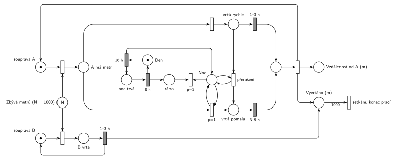

# 12–16 – Tunel

**Původ:** půlsemestrální písemka 2011/12, příklad 1 (bodování v zadání není).

**Zdroje:**

- `Fitcheats/Půlsemestrálky/Zadání z minulých let/2011-12.pdf`, str. 1 (zadání, příklad 1)

## Zadání

> Mezi místy A a B je třeba vykopat 1000 metrů dlouhý tunel. Z každé strany kope jiná vrtná souprava (souprava A/B). Souprava B vždy vrtá úsek jednoho metru dobu 1-3 hodiny. Souprava A je extrémně hlučná a proto musí v nočních hodinách vrtat pomalu (3-5 hodin na metr) a v denních hodinach smí pracovat běžnou rychlostí 1-3 hodiny na metr. Pokud v libovolném okamžiku vrtání běžnou rychlostí u soupravy A denní doba přejde z denních do nočních hodin, vrtání se přeruší a dále se rozpracovaný metrový úsek od počátku znovu opakuje v pomalém módu. Vrtné soupravy postupují proti sobě, přesto se však nesmí srazit. Práce se ukončí v okamžiku, kdy se soupravy potkají. Vyznačte v Petriho síti místo, které bude obsahovat informaci o počtu metrů od startovního místa A, kde dojde k setkání obou souprav. Noční doba trvá 8 hodin. Zvolte si vhodně počáteční čas.
>
> Modelujte zadaný systém ve formě Petriho sítě s vyznačením všech potřebných parametrů.

Věta „V modelu jednoznačně ukažte (přechodem) moment, kdy transakce opouští systém“ přibyla až v roce 2022/23. Výstupní přechod je v síti přesto, dnes se vyžaduje.

Podobné úlohy: [03–02 – Porucha vrací transakci do fronty](<../03–02 - Porucha vrací transakci do fronty/03–02 - Porucha vrací transakci do fronty.md>) (přerušená práce začíná znovu), [12–13 – Stavba z betonu](<../12–13 - Stavba z betonu/12–13 - Stavba z betonu.md>) (konečná práce, konec po N částech), [12–15 – Dílna se třemi stroji](<../12–15 - Dílna se třemi stroji/12–15 - Dílna se třemi stroji.md>).

## Interpretace

Zobrazit interpretaci (nápověda)

- **Tunel jako sklad metrů:** místo *Zbývá metrů* má N = 1000 značek. Souprava si metr **zabere na začátku** vrtání (okamžitý přechod bere značku soupravy a jeden metr). Poslední metr tak vezme jen jedna souprava a soupravy se nesrazí.
- **Den a noc** jsou dvě místa v cyklu `16 h` / `8 h` (noc trvá 8 h, den tedy 16 h). Počáteční čas: začátek dne, značka je v místě *Den*.
- **Režim soupravy A:** z místa *A má metr* vedou dva okamžité přechody. Pomalé vrtání má `p=1` a testuje místo *Noc* (dvojice hran), rychlé je bez podmínky (p=0). V noci tedy vyhraje pomalé, ve dne je pomalé neproveditelné a provede se rychlé. Je to Hrubého „if–else“ přes prioritu.
- **Přerušení při soumraku:** okamžitý přechod *přerušení* bere značku z *vrtá rychle* a testuje *Noc*. Jakmile začne noc, provede se, odpočet `1–3 h` zanikne (slajd 139) a souprava se vrátí do *A má metr*, odkud začne týž metr od začátku pomalu. Zabraný metr se přitom nevrací.
- Pomalé vrtání, které začalo v noci, doběhne pomalu i po rozednění; zadání přerušuje jen přechod ze dne do noci.
- **Vzdálenost od A:** každý metr soupravy A přidá značku do *Vzdálenost od A (m)*. Po setkání je v něm počet metrů od A, kde se soupravy potkaly.
- **Konec prací:** každý dokončený metr (A i B) přidá značku do *Vyvrtáno (m)*. Výstupní přechod s váhou 1000 je okamžik setkání. Den a noc se pak střídají dál, soupravy už nemají co vrtat.

## Řešení

Zobrazit řešení

| Požadavek | Prvek sítě |
|---|---|
| tunel 1000 m, soupravy se nesrazí | *Zbývá metrů* (N = 1000); metr se zabírá na začátku vrtání |
| B vrtá 1–3 h na metr | *souprava B* + metr → *B vrtá* → `1–3 h` → *souprava B* + *Vyvrtáno* |
| den 16 h, noc 8 h, začátek ráno | *Den* (1 značka) → `16 h` → *Noc* → `8 h` → *Den* |
| A v noci pomalu 3–5 h, ve dne 1–3 h | z *A má metr*: `p=1` s testem *Noc* → `3–5 h`, jinak → `1–3 h` |
| soumrak přeruší rychlé vrtání, metr znovu pomalu | *přerušení*: *vrtá rychle* + test *Noc* → *A má metr* |
| místo se vzdáleností setkání od A | *Vzdálenost od A (m)* |
| setkání, konec prací | *Vyvrtáno (m)* → váha 1000 → *setkání, konec prací* |

Kontrola simulací: platí *Den* + *Noc* = 1 a každá souprava je vždy v jednom stavu. Soupravy se setkají asi po 48 dnech zhruba 430 m od A (A urazí za den asi 9 m, B asi 12 m). Přerušení nastane skoro každý večer.

## Existující řešení

Zobrazit srovnání s existujícími řešeními

- K zadáním z roku 2011/12 v materiálech žádné řešení není.

## Časté chyby

Zobrazit časté chyby

- Metr zabíraný až na konci vrtání: obě soupravy pak můžou vrtat poslední metr současně a „srazí se“.
- Přerušení bez testu noci (nebo bez priority), takže se rychlé vrtání přeruší hned, nebo vůbec.
- Přerušený metr poslaný do pomalého vrtání s pokračujícím odpočtem; zadání chce úsek „od počátku znovu“, tedy nový odpočet `3–5 h`.
- Místo pro vzdálenost setkání, které počítá metry obou souprav dohromady (to je vždy 1000).
- Den a noc jako dva nezávislé generátory místo jednoho cyklu; pak se mohou překrývat.

