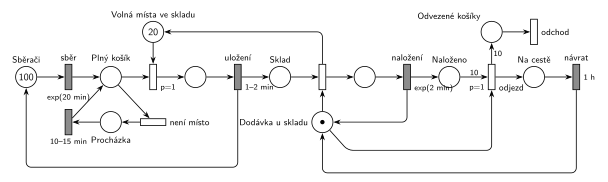

# 12–17 – Chmelová brigáda

## Zadání

> Na chmelové brigádě je 100 sběračů chmele. Doba sběru chmele do košíku se řídí exponenciálním rozložením se středem 20 minut. Po naplnění košíku jde sběrač košík uložit do skladu s kapacitou 20 košíků. Pokud ve skladu není aktuálně volné místo pro uložení košíku, sběrač se vydá s košíkem na 10-15 minut na procházku. Po návratu opět zkoumá volnou kapacitu skladu (počet procházek je neomezený). V případě volné kapacity skladu zabere uložení košíku do skladu 1-2 minuty rovnoměrně. Po uložení plného košíku s nasbíraným chmelem obdrží sběrač volný košík a vrací se ke sběru. Počty košíků v systému nesledujeme a zanedbáváme i doby přesunu sběrače mezi polem a skladištěm (tzn. není tam sklad volných košíků). V systému pracuje jedna přepravní dodávka s kapacitou 10 košíků. Naložení každého jednotlivého košíku do dodávky trvá dobu, která se řídí exponenciálním rozložením se středem 2 minuty. Okamžikem započetí nakládání košíku dodávkou se uvolňuje jedna pozice ve skladu. Po plném naložení dodávka odjíždí a vrací se prázdná za jednu hodinu.
>
> Poznámka: Kapacitu skladu plných košíků lze modelovat místem v Petriho síti se zadanou kapacitou.

Věta „V modelu jednoznačně ukažte (přechodem) moment, kdy transakce opouští systém“ v zadání není (přibyla až v roce 2022/23). Výstupní přechod je v síti přesto, dnes se vyžaduje.

Podobné úlohy: [12–02 – Sběrači jahod](<../12–02 - Sběrači jahod/12–02 - Sběrači jahod.md>), [12–04 – Jahodová farma](<../12–04 - Jahodová farma/12–04 - Jahodová farma.md>), [11–04 – Výletní loď](<../11–04 - Výletní loď/11–04 - Výletní loď.md>) (čítač do plna), [12–18 – Logistická centrála](<../12–18 - Logistická centrála/12–18 - Logistická centrála.md>) (stejný rok).

## Interpretace

Zobrazit interpretaci (nápověda)

 

- **Sběrači** jsou uzavřený cyklus: místo se 100 značkami a `exp(20 min)`. Každá značka má vlastní odpočet (slajd 138), takže všech 100 sběračů sbírá souběžně. Sběrači systém neopouštějí.
- **Kapacita skladu bez kapacity místa:** poznámka v zadání dovoluje místo s kapacitou 20, ale v notaci kurzu se kapacity míst nepoužívají. Místo nich je doplňkové místo *Volná místa ve skladu* s 20 značkami.
- **Volné místo, nebo procházka:** obsazení místa ve skladu má `p=1`, procházka `p=0`. Procházka se tedy provede, jen když žádné volné místo není. Po `10–15 min` se sběrač vrátí do *Plný košík* a zkouší to znovu.
- Místo ve skladu se zabere **na začátku ukládání** (`1–2 min`) a uvolní se **na začátku nakládání** do dodávky, jak říká zadání. Košík ve skladu je značka v *Sklad*. Platí tedy *Volná místa* + ukládané + *Sklad* = 20.
- **Dodávka** je zařízení s jednou značkou (*Dodávka u skladu*). Nakládá se po jednom košíku, `exp(2 min)`. Čítač *Naloženo* a přechod *odjezd* s váhou 10 a `p=1` jsou stejný vzor jako u výletní lodi: po 10. košíku odjezd předběhne další nakládání (oba potřebují značku dodávky).
- Po `1 h` se prázdná dodávka vrací. **Odvezené košíky** opouštějí systém (výstupní přechod *odchod*).
- Systém je silně přetížený: sběrači naplní asi 5 košíků za minutu, dodávka odveze 10 košíků zhruba za 80 minut. Sklad je skoro pořád plný a většina sběračů chodí na procházky. Síť je správně, zadání tak prostě vychází.

## Petriho síť

Zobrazit Petriho síť

 

| Požadavek | Prvek sítě |
|---|---|
| 100 sběračů, sběr exp(20 min) | *Sběrači* (100) → `exp(20 min)` → *Plný košík* |
| sklad s kapacitou 20 | *Volná místa ve skladu* (20 značek) |
| je-li místo, uložení 1–2 min | `p=1`: *Plný košík* + volné místo → `1–2 min` → *Sklad* a sběrač zpět do *Sběrači* |
| není-li místo, procházka 10–15 min | *není místo* (`p=0`) → *Procházka* → `10–15 min` → *Plný košík* |
| začátek nakládání uvolní místo | okamžitý přechod: *Sklad* + *Dodávka u skladu* → nakládání + volné místo |
| nakládání po jednom, exp(2 min) | `exp(2 min)` vrací značku dodávky → *Naloženo* |
| po 10 košících odjezd, návrat za 1 h | *odjezd* (`p=1`, váha 10) → *Na cestě* → `1 h` → *Dodávka u skladu* |
| odvezené košíky opouštějí systém | *Odvezené košíky* (váha 10) → *odchod* |

Kontrola simulací: platí *Sběrači* + *Plný košík* + ukládající + *Procházka* = 100, *Volná místa* + ukládané + *Sklad* = 20 a *Dodávka* + nakládání + *Na cestě* = 1. *Naloženo* nepřesáhne 10. Dodávka odjíždí zhruba každých 80 minut a procházky jsou nejčastější událost.

## Časté chyby

Zobrazit časté chyby

 

- Procházka bez nižší priority: sběrač by mohl jít na procházku, i když je ve skladu místo.
- Uvolnění místa ve skladu až po naložení košíku. Zadání ho uvolňuje okamžikem začátku nakládání.
- Dodávka s 10 značkami místo jedné: časovaný přechod pak nakládá všechny košíky souběžně.
- Odjezd bez `p=1`: po 10. košíku by mohlo začít nakládání 11.
- Hrana přechod → přechod nebo místo → místo (mezi ně vždy patří místo, resp. přechod).
- Místo s kapacitou 20 místo doplňkového místa (v notaci kurzu se nepoužívá).

## Původ a zdroje

Zobrazit původ a zdroje

 

**Původ:** půlsemestrální písemka 2010/11 (bodování neuvedeno).

**Zdroje:**

- `Fitcheats/Půlsemestrálky/Zadání z minulých let/2010-11.pdf`, str. 1 (zadání, úloha 3 „Chmel“)
- `Fitcheats/Skripta/FIT - Studentská skripta 2015-16.pdf`, str. 45–46 (zadání, dvě studentská řešení s komentáři)

**Existující řešení:**

- **Studentská skripta, str. 45 (kresleno na počítači, „bez záruky“):** sběrači, `p=1` uložení s „miesta v sklade“ (20), procházka `10-15m` a návrat do „plný košík“ jsou správně. Začátek nakládání vrací místo ve skladu. Chyby:
  - nakládání má `1-2m` místo `exp(2 min)`;
  - „dodávka“ má 10 značek, takže se může nakládat až 10 košíků najednou (komentář „začaly by se nakládat všechny košíky naráz“). Správně je jedna značka dodávky a čítač naložených košíků;
  - odvezené košíky nemají výstupní přechod.
- **Studentská skripta, str. 46 (ručně kreslené):** v podstatě totéž co tady: „MÁM KAM NALOŽIT“ (1 značka) = *Dodávka u skladu*, „NAKLÁDÁM“ `Exp(2min)`, „NALOŽENÉ“ s váhou 10, „ODJEZD“ s `P=1`, „AUTO SE VRACÍ“ po `1h`. Komentář pod ním upozorňuje na dvě syntaktické chyby: „nesmi byt: prechod -> prechod, stav -> stav“. Přechod „ODJEZD“ vede přímo do přechodu `1h` a procházka začíná hranou z místa rovnou do místa (chybí přechod, a tedy i nižší priorita procházky).
- Studentská poznámka „použitie kapacity v stave ‚sklad‘ by to značne zjednodušilo, ale Hrubý tuším povedal, že tomu sa máme vyhýbať“ odpovídá notaci kurzu: kapacitu nahrazuje doplňkové místo.

