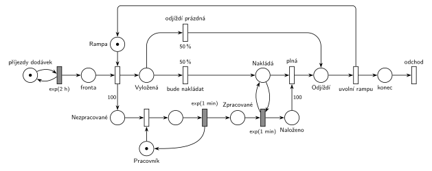

# 12–18 – Logistická centrála

**Původ:** půlsemestrální písemka 2010/11 (bodování neuvedeno).

**Zdroje:**

- `Fitcheats/Půlsemestrálky/Zadání z minulých let/2010-11.pdf`, str. 1 (zadání, úloha 2)
- `Fitcheats/Skripta/FIT - Studentská skripta 2015-16.pdf`, str. 44 (zadání a ručně kreslené studentské řešení s komentáři)

## Zadání

> Do logistické centrály přijíždí dodávky v intervalech daných exponenciálním rozložením se středem 2 hodiny. Dodávka přistupuje k centrále přes jednu nakládací/vykládací rampu. Dodávka přiveze 100 balíků ke zpracování. Dobu vyložení balíků zanedbáváme. Zpracováním přivezených balíků se zabývá jeden pracovník. Doba zpracování každého jednotlivého balíku se řídí exponenciálním rozložením se středem 1 minuta. Zpracované balíky jsou umístěny v centrále. Kapacitu centrály pro uložení přivezených nebo zpracovaných balíků nezkoumáme. Polovina dodávek po vyložení balíků nakládá zpracované balíky až po svou kapacitu 100 balíků, druhá polovina po vyložení okamžitě opouští systém. Doba naložení každého jednotlivého balíku se řídí exponenciálním rozložením se středem 1 minuta. Po plném naložení dodávka odjíždí a další její chování nezkoumáme.
>
> Poznámka: Pracovník zpracovávající přivezené balíky je nezávislý proces.

Věta „V modelu jednoznačně ukažte (přechodem) moment, kdy transakce opouští systém“ v zadání není (přibyla až v roce 2022/23). Výstupní přechod je v síti přesto, dnes se vyžaduje.

Podobné úlohy: [11–04 – Výletní loď](<../11–04 - Výletní loď/11–04 - Výletní loď.md>) (čítač do plna), [11–08 – Přepravní firma](<../11–08 - Přepravní firma/11–08 - Přepravní firma.md>), [12–17 – Chmelová brigáda](<../12–17 - Chmelová brigáda/12–17 - Chmelová brigáda.md>) (stejný rok).

## Interpretace

Zobrazit interpretaci (nápověda)

- **Rampa** je zařízení s jednou značkou. Dodávka ji drží od vyložení až do odjezdu, i během nakládání.
- **Vyložení trvá nulový čas**, proto je to jediný okamžitý přechod: obsadí rampu a hranou s váhou 100 vloží 100 značek do *Nezpracované*. Dodávka na zpracování svých balíků nečeká.
- **Pracovník je nezávislý proces:** vlastní zařízení *Pracovník*, které bere balíky z *Nezpracované* po jednom (`exp(1 min)`) a dává je do *Zpracované*. Do centrály se dostávají balíky ze všech dodávek dohromady.
- **50 % / 50 %** hned po vyložení. Nakládající dodávka je v místě *Nakládá*. Časovaný `exp(1 min)` ve smyčce s *Nakládá* bere vždy jeden zpracovaný balík, takže se nakládá po jednom. Když zpracované balíky dojdou, dodávka na rampě čeká.
- **Plná dodávka:** okamžitý přechod *plná* s hranou váhy 100 z *Naloženo*. Má přednost před dalším naložením (okamžitý přechod před časovaným), takže se 101. balík nenaloží. Naložené balíky odjíždějí s dodávkou, v síti zaniknou v přechodu *plná*.
- Obě větve se sejdou v místě *Odjíždí*. Přechod *uvolní rampu* vrátí značku rampě a dodávka odchází přechodem *odchod*. Kdo nakládá, zadání neříká. Pracovník to podle poznámky není, nakládání proto žádné další zařízení nebere.
- **Zásoba v centrále roste bez omezení:** přiváží každá dodávka, odváží jen polovina. Zadání to dovoluje („Kapacitu centrály … nezkoumáme“).

## Řešení

Zobrazit řešení

| Požadavek | Prvek sítě |
|---|---|
| dodávky po exp(2 h) | *generátor* ⇄ `exp(2 h)` → *Fronta* |
| jedna rampa, vyložení 100 balíků v nulovém čase | obsazení *Rampy* → *Vyložená* a váha 100 do *Nezpracované* |
| pracovník, zpracování exp(1 min) za balík | *Pracovník* (1 značka), obsazení, `exp(1 min)` vrací pracovníka → *Zpracované* |
| polovina odjíždí, polovina nakládá | `50 %` *odjíždí prázdná* / `50 %` *bude nakládat* |
| nakládání po jednom, exp(1 min) | *Nakládá* ⇄ `exp(1 min)` (bere 1 zpracovaný balík) → *Naloženo* |
| po 100 balících odjezd | *plná*: váha 100 z *Naloženo* + *Nakládá* → *Odjíždí* |
| uvolnění rampy, odchod ze systému | *uvolní rampu* (vrací *Rampu*) → *konec* → *odchod* |

Kontrola simulací: *Rampa* + *Vyložená* + *Nakládá* + *Odjíždí* = 1, *Pracovník* + zpracovávaný balík = 1, *Naloženo* ≤ 100. Zásoba *Zpracované* roste (asi o 50 balíků na dodávku). Fronta *Nezpracované* je stabilní (pracovník je vytížen asi na 83 %), ale po dávkách po 100 občas naroste na stovky kusů.

## Existující řešení

Zobrazit srovnání s existujícími řešeními

- **Studentská skripta, str. 44 (ručně kreslené):** „PRICHÁDZA DODÁVKA“ `exp(2h)` → přechod s „RAMPA“ → váha 100 do „BALÍKY NA VYLOŽENIE“ → `exp(1min)` s „PRACOVNÍK“ → „VYLOŽENÉ BALÍKY“ a „CENTRÁLA“ → váha 100 → `50%`: „PO VYLOŽENÍ ODCHOD“ / `50%`: „NAKLÁDÁ“ → `exp(1min)` (bere z centrály) → „NALOŽENÉ“ → váha 100 → „NALOŽENÁ ODCHÁDZA“. Obě odjíždějící větve vracejí rampu. Chyby:
  - pracovník se po zpracování balíku nevrací (komentář „Ten pracovník se nevrací?“). Zpracuje se tak jediný balík;
  - dodávka v síti zmizí a dál ji zastupuje 100 značek „vyložené balíky“. Rampu tedy drží, dokud pracovník nezpracuje všech 100 balíků. To odporuje „dobu vyložení zanedbáváme“ i poznámce, že pracovník je nezávislý proces. Navíc se tam míchají balíky různých dodávek;
  - chybí okamžité obsazení pracovníka (komentář pod řešením). Časovaný přechod se vstupem z místa zařízení by ale fungoval také.
- Diskuse pod řešením („Neměli by tam být odkonce 2 pracovníci, zvlášť na zpracování a nakládání?“) skončila správně: „v zadani je ze pracovnik se zabyva zpracovanim, nic vic“.

## Časté chyby

Zobrazit časté chyby

- Dodávka čeká na rampě, než se její balíky zpracují. Vyložení je okamžité a pracovník pracuje nezávisle.
- Pracovník, kterému se značka nevrací.
- Nakládání bez místa *Nakládá* ve smyčce: časovaný přechod jen se vstupem *Zpracované* by nakládal všechny balíky najednou (každá značka má vlastní odpočet, slajd 138).
- Odjezd bez hrany váhy 100, nebo bez návratu značky *Rampě*.
- Rozhodnutí 50 % / 50 % až po zpracování nebo s parametrem na hraně místo na přechodu.

