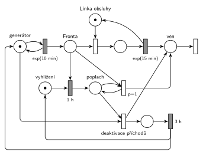

# M53 – Psí salon

Půlsemestrální písemka 2025/26, varianta A, 10 bodů (bodování podle ostatních let).

## Zadání

> ⚠️ **Rekonstrukce.** Zadání z roku 2025/26 v materiálech chybí, existuje jen Hrubého řešení. Text níže je odvozený z jeho sítě a poznámek („čekající zákazníci odchází ze salonu“, „deaktivace procesu příchodů“, „pokud kdokoli ve frontě čeká ≥ 1 h, pak …“). Čísla jsou převzatá z řešení.
>
> Do psího salonu přichází zákazníci v intervalech daných exponenciálním rozložením se středem 10 minut. Salon má jednu linku obsluhy, obsluha (stříhání) trvá dobu danou exponenciálním rozložením se středem 15 minut. Pokud některý zákazník čeká ve frontě alespoň 1 hodinu, všichni čekající zákazníci salon opustí a salon na 3 hodiny přestane přijímat nové zákazníky. V modelu jednoznačně ukažte (přechodem) moment, kdy transakce opouští systém.

Zdroj (cesta relativně ke složce `IMS - Modelování a simulace/`):

- `Fitcheats/Půlsemestrálky/Hrubý - Řešení 2025-26.pdf`, str. 1

Všimni si: obsluha (15 min) je pomalejší než příchody (10 min), takže bez pravidla s jednou hodinou by fronta rostla do nekonečna. Právě proto zadání dává smysl.

Podobné úlohy: [E28 – přerušení příchodů při délce fronty 5](../../exam/E28/), [E30 – vyprázdnění fronty](../../exam/E30/), [E01 – netrpěliví zákazníci](../../exam/E01/).

## Interpretace

- **Vyhlížení** je samostatný proces (místo se značkou). Časovaný přechod `1 h` je proveditelný, když je značka ve *vyhlížení* a někdo je ve *Frontě*. Odpočet tedy běží, dokud je fronta neprázdná („Trvá!“ v Hrubého řešení). Když se fronta mezitím vyprázdní, odpočet zanikne a s dalším zákazníkem začne znovu.
- To je **abstrakce**, kterou Hrubý výslovně přiznává: odpočet měří, jak dlouho je fronta nepřetržitě neprázdná, ne kolik čeká konkrétní zákazník. Přesnější alternativa (také jeho poznámka) je dát každé transakci vlastní timeout: časovaný přechod `1 h` jen se vstupem z *Fronty* (bez *vyhlížení*), který má podle slajdu 138 odpočet pro každou značku zvlášť.
- Přechod `1 h` vezme z fronty zákazníka, který čekal nejdéle. Ten se stane značkou v místě *poplach*. Odchází ze systému až přechodem *deaktivace příchodů*.
- **Vyprázdnění fronty:** okamžitý přechod s `p=1` opakovaně bere zákazníky z *Fronty* a vrací značku *poplach* zpět (smyčka), dokud fronta není prázdná. Priorita `p=1` zajistí, že vyprázdnění proběhne dřív než deaktivace (p=0) a dřív než případné obsazení linky.
- **Deaktivace příchodů** odebere značku generátoru, takže probíhající odpočet `exp(10 min)` zanikne a nikdo nepřichází. Po `3 h` se vrátí značka generátoru i vyhlížení.
- Zákazník, který je právě obsluhován, obsluhu normálně dokončí.

## Řešení

| Požadavek | Prvek sítě |
|---|---|
| příchody exp(10 min) | *generátor* ⇄ `exp(10 min)` → *Fronta* |
| jedna linka, obsluha exp(15 min) | *Linka obsluhy* (1 značka), obsazení, `exp(15 min)` vrací značku |
| někdo čeká ≥ 1 h | *vyhlížení* + *Fronta* → `1 h` → *poplach* |
| všichni čekající odcházejí | `p=1`: *poplach* + *Fronta* → *poplach* + *ven* |
| 3 h bez příchodů | *deaktivace příchodů* bere značku *generátoru* → `3 h` → zpět *generátor* a *vyhlížení* |
| odchod ze systému | místo *ven* → přechod bez výstupu |

Kontrola simulací: linka se vždy vrátí, platí *generátor* + pauza = 1 a *vyhlížení* + *poplach* + pauza = 1. Fronta zůstává omezená (nejvýš asi 16), i když je obsluha pomalejší než příchody.

## Existující řešení

- **Hrubý (str. 1):** síť výše je jeho řešení překreslené: stejná místa, přechody i priority. Generátor kreslí také jako místo ve smyčce s `exp(10min)`.

## Časté chyby

- Zastavení příchodů odebráním značky z *Fronty* místo z *generátoru*. Generátor musí přijít o svou značku, jinak příchody pokračují.
- Vyprázdnění fronty jedním přechodem s váhou hrany. Váha bere přesný počet značek, ne „všechny“. Na „všechny“ je potřeba smyčka s prioritou.
- Zapomenutá smyčka *poplach* → přechod → *poplach*: pak se odebere jen jeden zákazník.
- Zapomenutý návrat značky do *vyhlížení* po 3 h: hlídání by pak fungovalo jen jednou.
