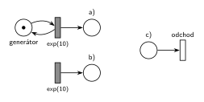
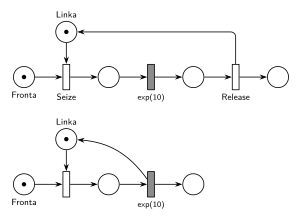
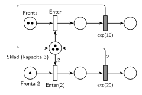
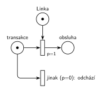
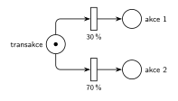
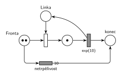
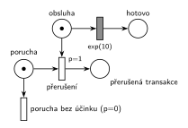
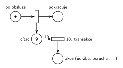
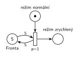
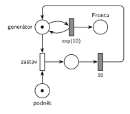

# Notace a vzory Petriho sítí (IMS)

Podle přednášek (Hrubý, `IMS - Prezentace.pdf`, slajdy 123–164 a 186–198) a Hrubého ručně kreslených řešení půlsemestrálek. Poznámky MSI (Vojnar) používají jinou konvenci (okamžitý přechod jako černá čárka, exponenciální jako bílý obdélník); u IMS ji nepoužívat.

## Prvky

| Prvek | Jak se kreslí | Zdroj |
|---|---|---|
| místo | kružnice; značky jako tečky, nebo číslo či symbol uvnitř (`50`, `N`); název vedle | sl. 128, 131, 197 |
| okamžitý přechod | tenký bílý obdélník (Hrubý rukou: tenká čárka) | sl. 132–164 |
| časovaný přechod | šedý (vyplněný) obdélník, čas pod ním: `exp(10)`, `5`, `uniform(10,15)`, `exp(4h)`; parametr `exp` je **střední hodnota** | sl. 136, 139, 151 |
| priorita | `p=1` u okamžitého přechodu; vyšší číslo = vyšší priorita, implicitně `p=0` | sl. 132 |
| pravděpodobnost | `30 %` u okamžitého přechodu; součet ve větvení = 100 % | sl. 134 |
| váha hrany | číslo u hrany, implicitně 1 | sl. 129 |
| inhibiční hrana | hrana zakončená prázdným kolečkem. Hrubý: „poslední roky bojuju proti těmto inhibičním hranám“, místo ní použij podmínku přes prioritu | sl. 133 |
| kapacita místa | nepoužívat; zdroj modeluj jako místo se značkami | studentská skripta |

**Jeden parametr na přechod** (sl. 135): časovaný přechod má jen čas. Okamžitý má buď prioritu, nebo pravděpodobnost, nikdy obojí. Parametr patří přechodu, ne hraně.

**U zkoušky a půlsemestrálky** se od roku 2022 vyžaduje: „V modelu jednoznačně ukažte (přechodem) moment, kdy transakce opouští systém“ a „s vyznačením atributů na přechodech a místech“. Každá síť tedy potřebuje výstupní přechod bez výstupních hran a pojmenovaná místa.

## Sémantika časovaného přechodu

- Odpočet začne, když se přechod stane proveditelným. **Během odpočtu zůstávají značky ve vstupních místech** a přesunou se až na jeho konci (sl. 137).
- Okamžitý přechod má vždy přednost před časovaným (sl. 139). Když si okamžitý přechod během odpočtu vezme značku, odpočet zanikne. **Na tom stojí přerušení obsluhy (poruchy) i netrpělivost.**
- Běžný časovaný přechod **neomezuje počet současně čekajících** (sl. 138): každá značka ve vstupním místě má vlastní odpočet. Kapacitu (frontu u přechodu) je potřeba připsat poznámkou.

## Vzory

### Generátor a odchod

a) Místo se značkou ve smyčce s časovaným přechodem (přednášející: „mírně korektnější“, místo je explicitně vidět). b) Zkrácený tvar: přechod bez vstupu. c) Odchod ze systému: okamžitý přechod bez výstupních hran.

**Procvičení:** [Opravářská dílna](<../exercises/01 - Základní modely/01 - Opravářská dílna/01 - Opravářská dílna.md>), [Zdravotní ordinace](<../exercises/01 - Základní modely/03 - Zdravotní ordinace/03 - Zdravotní ordinace.md>), [Fronta omezená na 10](<../exercises/02 - Netrpělivost a omezená fronta/04 - Fronta omezená na 10/04 - Fronta omezená na 10.md>), [Kopírovací centrum](<../exercises/09 - Obsluha zákazníků/10 - Kopírovací centrum/10 - Kopírovací centrum.md>).

### Zařízení (Facility)

Nahoře plný tvar ze slajdu 154 (Seize – obsluha – Release), dole zkrácený tvar ze slajdu 164, kde je uvolnění sloučené s časovaným přechodem. Oba jsou správně. Hlídej, aby se značka linky **vždy** vrátila.

**Procvičení:** [Opravářská dílna](<../exercises/01 - Základní modely/01 - Opravářská dílna/01 - Opravářská dílna.md>), [Zdravotní ordinace](<../exercises/01 - Základní modely/03 - Zdravotní ordinace/03 - Zdravotní ordinace.md>), [Telefonní ústředna](<../exercises/09 - Obsluha zákazníků/22 - Telefonní ústředna/22 - Telefonní ústředna.md>), [Pizza stánek](<../exercises/09 - Obsluha zákazníků/05 - Pizza stánek/05 - Pizza stánek.md>).

### Sklad (Store)

Místo s N značkami. Transakce, která potřebuje víc jednotek najednou, má hranu s váhou (zabere i vrátí stejný počet).

**Procvičení:** [Samoobsluha](<../exercises/01 - Základní modely/02 - Samoobsluha/02 - Samoobsluha.md>), [MM3 – zastavení příchodů](<../exercises/05 - Délka fronty a kapacita/06 - MM3 – zastavení příchodů/06 - MM3 – zastavení příchodů.md>), [Cestovní kancelář](<../exercises/09 - Obsluha zákazníků/08 - Cestovní kancelář/08 - Cestovní kancelář.md>), [Údržba zabere celou kapacitu](<../exercises/05 - Délka fronty a kapacita/09 - Údržba zabere celou kapacitu/09 - Údržba zabere celou kapacitu.md>), [Kopírovací centrum s poruchami](<../exercises/09 - Obsluha zákazníků/11 - Kopírovací centrum s poruchami/11 - Kopírovací centrum s poruchami.md>).

### Podmínka přes prioritu (if–else)

Přechod `p=1` se provede, pokud může (linka je volná); jinak přijde na řadu přechod s `p=0`. Takhle Hrubý modeluje podmínky místo inhibičních hran (sl. 153).

**Procvičení:** [Fronta omezená na 10](<../exercises/02 - Netrpělivost a omezená fronta/04 - Fronta omezená na 10/04 - Fronta omezená na 10.md>), [Výletní autobus](<../exercises/11 - Doprava a dávky/01 - Výletní autobus/01 - Výletní autobus.md>), [Vyhlídkové lety](<../exercises/11 - Doprava a dávky/02 - Vyhlídkové lety/02 - Vyhlídkové lety.md>), [Obslužné centrum](<../exercises/09 - Obsluha zákazníků/02 - Obslužné centrum/02 - Obslužné centrum.md>).

### Pravděpodobnostní větvení

**Procvičení:** [Opravářská dílna](<../exercises/01 - Základní modely/01 - Opravářská dílna/01 - Opravářská dílna.md>), [Zdravotní ordinace](<../exercises/01 - Základní modely/03 - Zdravotní ordinace/03 - Zdravotní ordinace.md>), [Telefonní ústředna](<../exercises/09 - Obsluha zákazníků/22 - Telefonní ústředna/22 - Telefonní ústředna.md>), [Kopírovací centrum](<../exercises/09 - Obsluha zákazníků/10 - Kopírovací centrum/10 - Kopírovací centrum.md>).

### Netrpělivost (timeout ve frontě)

Časovaný přechod přímo na místě *Fronta*. Každý čekající má vlastní odpočet; kdo se dostane k lince dřív, tomu odpočet zanikne.

**Procvičení:** [Netrpělivé požadavky](<../exercises/02 - Netrpělivost a omezená fronta/01 - Netrpělivé požadavky/01 - Netrpělivé požadavky.md>), [Netrpělivý první ve frontě](<../exercises/02 - Netrpělivost a omezená fronta/02 - Netrpělivý první ve frontě/02 - Netrpělivý první ve frontě.md>), [Kopírovací centrum](<../exercises/09 - Obsluha zákazníků/10 - Kopírovací centrum/10 - Kopírovací centrum.md>), [Vyhlídková loď na molu](<../exercises/11 - Doprava a dávky/07 - Vyhlídková loď na molu/07 - Vyhlídková loď na molu.md>).

### Přerušení obsluhy (porucha)

Okamžitý přechod s prioritou vezme značku čekající v časovaném přechodu obsluhy (sl. 139). Porucha, která přijde, když se nic neobsluhuje, musí zaniknout (`p=0`), jinak se poruchy hromadí.

**Procvičení:** [Porucha zruší obsluhu](<../exercises/03 - Poruchy/01 - Porucha zruší obsluhu/01 - Porucha zruší obsluhu.md>), [Porucha vrací transakci do fronty](<../exercises/03 - Poruchy/02 - Porucha vrací transakci do fronty/02 - Porucha vrací transakci do fronty.md>), [Porucha s opravou, návrat do fronty](<../exercises/03 - Poruchy/03 - Porucha s opravou, návrat do fronty/03 - Porucha s opravou, návrat do fronty.md>), [Kopírovací centrum s poruchami](<../exercises/09 - Obsluha zákazníků/11 - Kopírovací centrum s poruchami/11 - Kopírovací centrum s poruchami.md>), [Zahradnictví a bouřka](<../exercises/12 - Výroba a sklady/01 - Zahradnictví a bouřka/01 - Zahradnictví a bouřka.md>).

### Čítač – každá N-tá transakce

Každá transakce přidá značku do *čítače*. Hrana s váhou 10 se provede, až je jich 10, a zároveň čítač vynuluje (odebere všech 10).

**Procvičení:** [Údržba po každé 10. obsluze](<../exercises/04 - Údržba a spánek/06 - Údržba po každé 10. obsluze/06 - Údržba po každé 10. obsluze.md>), [Každá 10. transakce vyvolá poruchu](<../exercises/03 - Poruchy/07 - Každá 10. transakce vyvolá poruchu/07 - Každá 10. transakce vyvolá poruchu.md>), [Automat na kávu – údržba po 50 obsluhách](<../exercises/04 - Údržba a spánek/02 - Automat na kávu – údržba po 50 obsluhách/02 - Automat na kávu – údržba po 50 obsluhách.md>), [Server s údržbou po 1000 požadavcích](<../exercises/10 - Počítačové systémy/01 - Server s údržbou po 1000 požadavcích/01 - Server s údržbou po 1000 požadavcích.md>), [Výletní loď](<../exercises/11 - Doprava a dávky/04 - Výletní loď/04 - Výletní loď.md>).

### Test délky fronty

Dvojice hran s váhou k (do přechodu a zpět) otestuje, že je ve frontě aspoň k transakcí, a nic z ní neodebere. Pozor na rozdíl mezi „dosáhne 5“ (váha 5) a „přesáhne 5“ (váha 6).

**Procvičení:** [Doba obsluhy podle délky fronty](<../exercises/05 - Délka fronty a kapacita/01 - Doba obsluhy podle délky fronty/01 - Doba obsluhy podle délky fronty.md>), [Natrvalo MM3 při dlouhé frontě](<../exercises/05 - Délka fronty a kapacita/03 - Natrvalo MM3 při dlouhé frontě/03 - Natrvalo MM3 při dlouhé frontě.md>), [Cestovní kancelář](<../exercises/09 - Obsluha zákazníků/08 - Cestovní kancelář/08 - Cestovní kancelář.md>), [Úřad](<../exercises/09 - Obsluha zákazníků/01 - Úřad/01 - Úřad.md>), [Centrum MM1 s rychlým režimem](<../exercises/09 - Obsluha zákazníků/04 - Centrum MM1 s rychlým režimem/04 - Centrum MM1 s rychlým režimem.md>).

### Dočasné zastavení příchodů

Okamžitý přechod odebere značku *generátoru*, takže odpočet příchodu zanikne. Po uplynutí doby se značka vrátí.

**Procvičení:** [Přerušení příchodů při plné frontě](<../exercises/05 - Délka fronty a kapacita/05 - Přerušení příchodů při plné frontě/05 - Přerušení příchodů při plné frontě.md>), [MM3 – zastavení příchodů](<../exercises/05 - Délka fronty a kapacita/06 - MM3 – zastavení příchodů/06 - MM3 – zastavení příchodů.md>), [Klientské centrum](<../exercises/09 - Obsluha zákazníků/06 - Klientské centrum/06 - Klientské centrum.md>), [Psí salon](<../exercises/09 - Obsluha zákazníků/03 - Psí salon/03 - Psí salon.md>), [Banka a lupič](<../exercises/09 - Obsluha zákazníků/21 - Banka a lupič/21 - Banka a lupič.md>).
